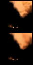
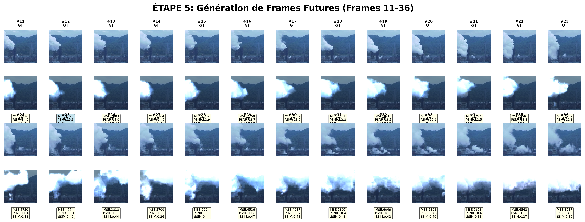

# Modélisation des panaches de fumée industriels — Flow Matching

Pipeline PyTorch de préparation de vidéos, extraction des panaches par matting,
compression VQGAN et prédiction vidéo par Flow Matching dans l'espace latent.
Le preset principal utilise des images **64×64 RGB → latents 8×8×256**.

## Résultats visuels historiques

### Reconstruction VQGAN



### Génération Flow Matching



| Vidéos réelles | Vidéos générées |
|---|---|
|  |  |

Ces médias proviennent d'expériences antérieures. Leurs poids et configurations
exactes ne sont pas livrés avec le dépôt : ils ne constituent pas une validation
du preset actuel. Voir le [registre d'expériences](doc/EXPERIMENT_REGISTRY.md).

## Ce qui est fourni

Le dépôt contient le code, les configurations, les métadonnées du dataset et des
médias. **Les vidéos, `final_dataset/`, les listes de splits et les checkpoints
entraînés ne sont pas versionnés.** Les chemins de poids dans les YAML désignent
des fichiers à produire ou à fournir localement, pas des téléchargements inclus.

Les commandes suivantes s'exécutent dans un même terminal **Bash, depuis la
racine du dépôt**. Ne poursuivre qu'après le succès de chaque étape.

## Installation

```bash
git clone https://github.com/omdrift/Modelisation-panaches-de-fum-es-industrielles-par-Flow-Matching.git
cd Modelisation-panaches-de-fum-es-industrielles-par-Flow-Matching
conda env create -f environment.yml -n river
conda activate river
python -c 'import torch, torchvision, wandb; print(torch.__version__, torch.cuda.is_available())'
```

`environment.yml` est un export Linux avec Python 3.9.18, PyTorch 2.1.1,
torchvision 0.16.1 et CUDA 12.1, incluant des builds précis. Il ne garantit pas
la compatibilité avec tous les systèmes ou GPU ; adapter l'installation PyTorch
au matériel si nécessaire. Le VQGAN utilise les poids VGG16 de torchvision,
téléchargés au premier lancement si le cache est vide.

Vérification des configurations sans supposer les données et poids présents :

```bash
python tools/validate_config.py configs/*.yaml \
  --allow-missing-data --allow-missing-checkpoints
```

Ce contrôle vérifie la structure et les dimensions, pas la compatibilité d'un
checkpoint absent ni la qualité des résultats.

## 1. Préparer les données

Les métadonnées du 24 février 2020 proviennent de Project RISE. Le téléchargeur
sélectionne le label `23` (Strong Positive), exclut `-2` et sauvegarde les MP4
directement dans `smoke_videos/`. Le nombre de clips effectivement obtenus dépend
des URL encore accessibles ; contrôler son bilan des échecs.

Pour une préparation neuve :

```bash
python prepare_data/dataset_init.py
python prepare_data/prepare_dataset.py \
  --input-dir smoke_videos --output-dir frames --require-matting
python prepare_data/organize_dataset.py \
  --src-root frames --dst-root final_dataset
```

L'extraction calcule un fond médian et un trimap puis applique le matting. Elle
fonctionne sans affichage par défaut ; ajouter `--show-monitor` pour une fenêtre
OpenCV. `--require-matting` refuse le mode de secours si pymatting est absent.

L'organisation sépare les **vidéos sources** à 80 % / 10 % / 10 %. Elle refuse une
destination non vide pour préserver des splits existants. Si le dataset est déjà
préparé, passer directement aux contrôles sans relancer l'organisation.

```text
final_dataset/
├── train/  # <video>_frame_0000.png, ...
├── val/
├── test/
├── train.txt
├── val.txt
├── test.txt
└── dataset_stats.json
```

Chaque ligne d'une liste référence une frame, par exemple
`train/<video>_frame_0000.png 1`. VQGAN lit les trois fichiers `<split>.txt`.
Flow Matching accepte aussi `<split>_files.txt` et regroupe les frames par vidéo.

```bash
python tools/validate_dataset.py \
  --root final_dataset --split train --num-samples 20 --min-sequence-frames 1
```

Ce contrôle examine les listes, les chevauchements de vidéos entre splits et un
échantillon d'images. Il ne vérifie pas toutes les images. Pour diagnostiquer les
clips trop courts pour l'évaluation du preset 64, relancer avec
`--min-sequence-frames 16`. Les chargeurs Flow Matching excluent ces clips :
10 frames minimum pour le train et 16 pour la validation de ce preset.

## 2. Entraîner le VQGAN 64×64

```bash
python tools/validate_config.py configs/vqgan_64.yaml
python train_vqgan.py \
  --config configs/vqgan_64.yaml \
  --run-name vqgan_64_baseline \
  --output-dir runs_vqgan/vqgan_64_baseline \
  --batch-size 4 --num-workers 2 \
  --epochs 50 --lr 0.0002 \
  --disc-start 10000 --save-every 5
```

`--disc-start` compte des **pas d'optimisation**, pas des epochs.
`--save-every` compte des epochs. Les autres options sont listées par
`python train_vqgan.py --help`. Les poids des pertes se règlent notamment avec
`--perceptual-weight` et `--adversarial-weight`.

La configuration VQGAN place `encoder`, `decoder` et `vector_quantizer` à la
racine, puis `batch_size`, `learning_rate` et `epochs` sous `training`.
Les builders actuels conservent leurs largeurs internes par défaut ; les champs
`mid_channels` ne sont pas transmis aux constructeurs. Ne pas supposer qu'une
modification de ces champs change l'architecture d'un checkpoint.

Checkpoint attendu **après réussite de la commande** :

```text
runs_vqgan/vqgan_64_baseline/checkpoints/vqgan_epoch_50.ckpt
```

Le script écrit aussi `config.yaml`, les reconstructions et les poids finaux.
Sans `--output-dir`, il préfixe le nom de run par `vqgan_` si nécessaire.

## 3. Entraîner Flow Matching

Le preset `configs/flow_matching_64.yaml` attend exactement le checkpoint VQGAN
produit ci-dessus. Le validateur et le train s'arrêtent si les entrées manquent.

```bash
python tools/validate_config.py configs/flow_matching_64.yaml
python train.py \
  --run-name flow_smoke_v1 \
  --config configs/flow_matching_64.yaml \
  --num-gpus 1 --random-seed 1543
```

Le train charge une fenêtre de **10 observations**, échantillonne une frame
cible, sa référence précédente et une condition antérieure, puis régresse le
champ vectoriel en latent. Il ne prédit pas une séquence entière à chaque loss.
`condition_frames` règle les frames initiales fournies en évaluation ; le sampler
d'entraînement choisit toujours une condition antérieure.

Pour ce preset, l'évaluation part de **1 frame initiale et génère 6 frames**.
`data.frames_per_sample=16` couvre la fenêtre de contrôle de 10 + 6 frames.
L'inférence autorise d'autres horizons, à valider expérimentalement.

| Paramètre | Valeur du preset principal |
|---|---:|
| `training.optimizer.num_training_steps` | 100000 |
| `training.eval_every` | 1000 steps |
| `training.checkpoint_every` | 2000 steps |
| `evaluation.steps` | 50 points d'intégration ODE |
| `training.batching.batch_size` | 24 |

Ajuster le batch dans le YAML selon la mémoire disponible ; aucune taille n'est
garantie pour tous les GPU. Le train refuse un dataset trop petit pour fournir
un batch avec `drop_last=True`. Il n'existe pas d'option `--accumulation-steps`.

Le dossier est **`runs/<run-name>/`**, indépendamment du nom du YAML :

```text
runs/flow_smoke_v1/
├── config.yaml  # Copie du YAML au premier lancement
└── checkpoints/
    ├── step_2000.pth
    ├── ...
    └── step_100000.pth  # Seulement après réussite du run à 100000 steps
```

Pour reprendre un checkpoint réellement présent avec la même configuration :

```bash
test -f runs/flow_smoke_v1/checkpoints/step_2000.pth && \
python train.py --run-name flow_smoke_v1 \
  --config configs/flow_matching_64.yaml --num-gpus 1 --resume-step 2000
```

Les chemins relatifs des YAML sont valides depuis la racine du dépôt.
Ne pas substituer un ancien `step_120000.pth` absent à un checkpoint produit.

## 4. Évaluer un run terminé

```bash
test -f runs/flow_smoke_v1/checkpoints/step_100000.pth && \
python evaluate_flow_matching.py \
  --config configs/flow_matching_64.yaml \
  --checkpoint runs/flow_smoke_v1/checkpoints/step_100000.pth \
  --split test --num-samples 3 --num-test-videos 3 --steps 50 \
  --output-dir evaluation_outputs/flow_smoke_v1
```

L'évaluation autonome écrit `metrics_summary.json`, `config_snapshot.yaml`, des
frames, GIF et grilles. Elle calcule MSE, PSNR et SSIM image si scikit-image est
disponible. **Elle ne calcule pas le FVD.** Conserver le checkpoint autoencodeur :
le modèle le charge pendant sa construction avant de charger les poids FM.

Le raccourci transmet les arguments à cet évaluateur, sans ancien poids codé en dur :

```bash
python quick_eval_test.py \
  --config configs/flow_matching_64.yaml \
  --checkpoint runs/flow_smoke_v1/checkpoints/step_100000.pth
```

## Reconstruction et génération sur une vidéo locale

Sélectionner un MP4 réellement disponible. Les deux checkpoints des étapes
précédentes sont requis ; les commandes ne les téléchargent pas.

```bash
VIDEO=$(find smoke_videos -maxdepth 1 -type f -name '*.mp4' -print -quit)
test -n "$VIDEO" && test -f "$VIDEO" || { echo 'Aucun MP4 disponible'; exit 1; }

python visualize_vqgan_reconstruction.py \
  --config configs/vqgan_64.yaml \
  --checkpoint runs_vqgan/vqgan_64_baseline/checkpoints/vqgan_epoch_50.ckpt \
  --video "$VIDEO" --num-frames 5 --output vqgan_comparison.png

python test/test_video_generation.py \
  --config configs/flow_matching_64.yaml \
  --checkpoint runs/flow_smoke_v1/checkpoints/step_100000.pth \
  --video "$VIDEO" --num-condition 1 --output-grid prediction_grid.png

python test/test_wandb_exact.py \
  --config configs/flow_matching_64.yaml \
  --checkpoint runs/flow_smoke_v1/checkpoints/step_100000.pth \
  --video "$VIDEO" --num-condition 1 --max-generate 6 \
  --output-video generation.mp4 --output-grid generation_grid.png
```

`test_video_generation.py` calcule l'horizon depuis les frames disponibles ;
`test_wandb_exact.py` permet de le limiter via `--max-generate`. Malgré son nom,
ce dernier ne garantit pas de reproduire exactement un ancien run WandB.
Les anciens scripts `test/test_vqgan*.py` et `test/test_vqvae.py` contiennent des
chemins locaux historiques ; utiliser la commande de reconstruction ci-dessus.

## Configurations disponibles

| Configuration | Entrée / latent | Usage et artefact requis |
|---|---|---|
| `vqgan_64.yaml` | 64×64 / 8×8×256 | Preset VQGAN principal, produit le poids de la procédure |
| `flow_matching_64.yaml` | 64×64 / 8×8×256 | Preset FM principal ; poids `vqgan_64_baseline`, 100000 steps |
| `smoke_dataset_vqgan.yaml` | 64×64 / 8×8×256 | Variante FM 150000 steps ; même poids VQGAN de référence |
| `smoke_dataset_optimized.yaml` | 64×64 / 8×8×256 | Variante : 16 observations, 2 conditions initiales, 14 futures ; fenêtre 30 |
| `flow_matching_128.yaml` | 128×128 / 16×16×256 | Variante secondaire ; poids 128 px à fournir, non livré |
| `smoke_dataset.yaml` | 128×128 / 16×16×256 | Variante historique ; fenêtre corrigée à 19 et poids 128 px à fournir |
| `config_vqgan.yaml` | 64×64 / 8×8×256 | Ancienne configuration VQGAN compatible avec le script |
| `config_vqvae.yaml` | 128×128 / 16×16×64 | VQ-VAE distinct ; incompatible avec un régresseur FM à 256 canaux |

Les chemins des variantes 128 px sont des emplacements attendus, pas une preuve
qu'un entraînement ou une validation a été réalisé. Ne pas attribuer les médias
historiques à ces presets sans leur configuration et checkpoint d'origine.

## Suivi, outils et tests

Ajouter `--wandb` aux commandes d'entraînement après `wandb login` pour activer le
suivi. Le train FM logge notamment `Training/Loss/flow_matching`,
`Training/LR`, `Validation/Loss/flow_matching_loss` et les médias de validation.
Il ne produit pas automatiquement de FVD, de SSIM temporel ou de courbes ODE.
Le bloc `logging:` d'anciennes instructions n'est pas utilisé : régler les
fréquences dans `training.eval_every` et `training.checkpoint_every`.

```bash
python prepare_data/filter_small_smoke.py --data-root final_dataset --min-ratio 0.05
python visualize_smoke_threshold.py --data-root final_dataset --split train --num-samples 500
```

Le filtre écrit des listes `.filtered` sans copier les images ; `--backup` permet
de sauvegarder puis remplacer les listes originales. Il n'active pas les listes
filtrées automatiquement par défaut.

La suite `tests/` utilise des données synthétiques et ne nécessite pas les
artefacts historiques. Elle requiert les dépendances du projet et pytest :

```bash
python -m pip install pytest
python -m pytest tests -q
```

Les scripts historiques dans `test/` ne font pas partie de cette suite autonome.
Voir aussi le [pipeline actuel](doc/SMOKE_FLOW_MATCHING_PIPELINE.md).

## Références

- [Project RISE : Recognizing Industrial Smoke Emissions](https://arxiv.org/abs/2005.06111), Hsu et al., AAAI 2021.
- [Efficient Video Prediction via Sparsely Conditioned Flow Matching](https://arxiv.org/abs/2211.14575), Davtyan, Sameni et Favaro, ICCV 2023.
- [Implémentation RIVER de référence](https://github.com/araachie/river).
