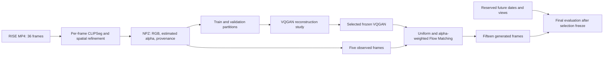
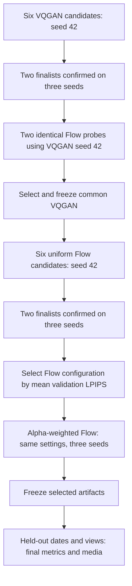

# Industrial Plume Forecasting

Reproducible industrial smoke video forecasting with CLIPSeg preprocessing, VQGAN representations and temporally conditioned Flow Matching inspired by [RIVER](https://arxiv.org/abs/2211.14575).

Each prepared clip retains **36 consecutive RGB frames at 64×64**, including intervals without smoke. Forecast evaluation uses **5 observed frames followed by 15 generated frames**. Estimated soft masks support regional diagnostics and a smoke-weighted loss. The experiment evaluates two-dimensional visual prediction; it does not measure emissions, physical concentration or validated three-dimensional dynamics.

The repository provides controlled hyperparameter comparisons, validation-only model selection, early stopping, recoverable checkpoints, fixed image/animation panels and held-out evaluation. No completed multi-seed forecasting result or optimal hyperparameter setting is claimed.

## Data and prediction



CLIPSeg operates independently on each source frame before spatial reduction. Future real images are never inputs to forecast generation. Acquisition intervals are preserved in the manifests; GIF playback speed is not a physical time reference.

## Installation

The canonical environment uses Python 3.11, PyTorch 2.7.1 and CUDA 12.8. Optuna **4.6.0** supplies sequential study storage and pruning.

```bash
conda env create -f environment_scientific.yml
conda activate smoke-science
python -m scientific.cli doctor
python -m pytest -q
```

For an existing environment, run `conda env update -n smoke-science -f environment_scientific.yml`. Optuna can also be installed in that environment with `python -m pip install optuna==4.6.0`.

## Controlled VQGAN and Flow Matching study

The study declares six candidates per model: learning rates **5e-5, 1e-4 and 2e-4**, each with a constant or cosine schedule. Architecture, effective batch size 16, losses and data stay fixed. These are experimental hypotheses, not established optimal values.

First inspect the execution plan. This command creates no output and starts no training:

```bash
python -m scientific.cli study \
  --config configs/experiment_study.yaml \
  --data scientific_data/v1_2_clipseg_fast \
  --output runs_scientific/plume_study \
  --dry-run
```

Launch the complete study with one command:

```bash
python -m scientific.cli study \
  --config configs/experiment_study.yaml \
  --data scientific_data/v1_2_clipseg_fast \
  --output runs_scientific/plume_study \
  --wandb
```

Online tracking requires an existing W&B login (`python -m wandb login`). Without `--wandb`, local structured logs, plots, images and reports remain available. Append `--resume` to resume the same study after an interruption.



| Phase | Maximum training runs | Maximum updates per run |
|---|---:|---:|
| VQGAN exploration + finalist confirmation | 6 + 6 | 15,000 / 50,000 |
| Flow probes to compare VQGAN finalists | 2 | 15,000 |
| Uniform Flow exploration + finalist confirmation | 6 + 6 | 15,000 / 50,000 |
| Alpha-weighted Flow with selected settings | 3 | 50,000 |
| **Total** | **29** | Early stopping may shorten each run |

Confirmation seeds are **17, 42 and 2026**. VQGAN selection considers reconstruction first and forecasting performance second. Flow configuration selection uses mean validation LPIPS across seeds. Tests remain unavailable for selection until configurations and artifacts are frozen. Pruned, failed and interrupted trials remain in the study record.

VQGAN validation runs every 250 updates with patience 10; Flow validation runs every 2,500 updates with patience four. Patience starts after 5,000 updates, with significant improvement `min_delta=1e-4`. The raw minimum still selects `best.pth`. Exploration uses one fixed Flow realization per window; confirmations, VQGAN comparison probes and final tests average four realizations without selecting the best sample.

Synthetic resource probes measure VQGAN memory and update time, then predictor throughput. These probes do not score the dataset. Validation, visualization and export time are additional to the measured optimizer-update time.

During an active run, two recovery checkpoints and the best state are retained. A completed exploratory trial keeps `weights.pth` and its provenance; finalists keep their full selected `best.pth`. The study registry resumes completed trials without retaining redundant numbered checkpoints.

## Images, monitoring and interpretation

- Fixed train/validation panels contain up to 60 windows, with eight examples reserved for visual comparisons.
- VQGAN exports original/reconstruction/error grids and 36-frame animations. Flow exports the five observations and all fifteen future frames with prediction/error comparisons.
- Plots cover LPIPS, MSE, PSNR, SSIM, smoke/background errors, codebook utilization, learning rates, gradient norms, memory, elapsed time and early-stopping progress.
- Flow objective diagnostics use fixed random draws on train and validation. Their latent velocity error is distinct from decoded-image LPIPS, which controls model selection.
- After final selection, the two held-out partitions receive metrics, reconstructions/predictions, animations and horizon curves. No intermediate test score guides tuning.

Train/validation gaps and trends are descriptive. An early stop or a minimum validation score does not prove the absence of overfitting. Repeated validation-based selection can itself introduce bias; the search is bounded and its entire comparison history is retained. See the [training and chart guide](doc/TRAINING_DESIGN.md).

## Prepared data and fixed-configuration pipeline

A complete prepared dataset can be used without the source MP4s. Keep the NPZ files, `dataset_manifest.json` and all partition manifests together. Changing segmentation requires the original videos.

To prepare a new dataset:

```bash
python -m scientific.cli inventory --output scientific_data/inventory.json
python -m scientific.cli download --videos smoke_videos
python -m scientific.cli prepare \
  --videos smoke_videos --output scientific_data/smoke \
  --cache-dir scientific_models/huggingface --device cuda
```

The study audits train/validation before search and all partitions after selection. The separate `check-data` command performs a full dataset check; within this study, use it after the selection freeze.

The separate `pipeline` command executes a declared fixed configuration, including persistence, Farnebäck optical flow and compact SimVP comparisons. It does not perform hyperparameter selection:

```bash
python -m scientific.cli --context-frames 5 --horizon 15 pipeline \
  --data scientific_data/v1_2_clipseg_fast \
  --campaign runs_scientific/smoke \
  --wandb --wandb-project smoke-science
```

Its defaults remain defined in `configs/scientific_protocol.yaml`; the controlled study explicitly overrides its own schedules, validation intervals and exposure limits. Frozen configurations are checked on resume.

## Documentation

- [Scientific protocol](doc/SCIENTIFIC_PROTOCOL.md)
- [Training design and metric interpretation](doc/TRAINING_DESIGN.md)
- [Execution and recovery guide](doc/SCIENTIFIC_RUNBOOK.md)
- [Architecture and diagrams](doc/ARCHITECTURE.md)
- [Engineering contracts and verification](doc/ENGINEERING.md)
- [Literature](doc/SCIENTIFIC_LITERATURE.md) and [BibTeX](doc/references.bib)

The import namespace `scientific`, existing commands and environment name `smoke-science` remain stable. Local videos, NPZ datasets, cached model weights, checkpoints and tracking sessions are excluded from Git. The public repository contains implementation, protocols, references, tests and license notices.

## Limitations and license

CLIPSeg can confuse smoke, steam, clouds and background structures. Alpha masks are semantic estimates, not independent annotations or calibrated opacity. LPIPS and regional image errors measure visual similarity; FVD is reserved for an extension with justified sequence lengths and sample counts.

Code is distributed under [GPL-3.0](LICENSE), consistent with RIVER-derived components. See [third-party notices](THIRD_PARTY_NOTICES.md) and [contribution procedures](CONTRIBUTING.md).
