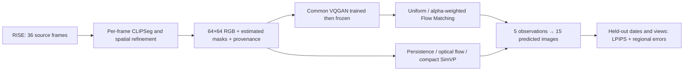

# Industrial Plume Forecasting

Reproducible video forecasting of industrial smoke using CLIPSeg preprocessing, a VQGAN latent representation, and sparsely conditioned Flow Matching inspired by [RIVER](https://github.com/araachie/river).

The reference experiment retains all **36 consecutive frames** of every source clip. Each frame is segmented at source resolution with CLIPSeg and a spatial guided filter, then stored at **64×64 RGB** with a soft alpha mask. The reference forecast task uses **5 observed images followed by 15 future images**. The full clip remains available to preprocessing, training and automatic checks.

The comparison contains persistence, Farnebäck optical-flow extrapolation, compact SimVP, uniform Flow Matching, and alpha-weighted Flow Matching. No physical concentration, emissions or validated three-dimensional plume dynamics are inferred from the RGB experiment.

The implementation provides dataset checks, sequential orchestration, validation-based early stopping, checkpoint recovery, fixed-panel diagnostics and held-out evaluation. The protocol and software are available; consolidated forecasting results and a calibrated optimal learning rate have not been established.



## Installation

The tested environment is Python 3.11 with PyTorch 2.7.1 and CUDA 12.8.

```bash
conda env create -f environment_scientific.yml
conda activate smoke-science
python -m scientific.cli doctor
python -m pytest -q
```

`doctor` checks installed dependencies and CUDA availability without downloading data or starting training.

## Complete campaign

The canonical entry point is the sequential pipeline. It prepares data, verifies manifests, runs the resource pilot, trains the common VQGAN, trains all predictor seeds, evaluates both held-out splits, and writes the final summary.

The supplied hyperparameters are exploratory starting values. The pipeline executes the declared recipe; it does not tune it. Before a confirmatory study, register a controlled calibration on training/validation data and freeze its selected configuration. The [training design and chart guide](doc/TRAINING_DESIGN.md) documents parameter origins, differences from RIVER/VQGAN, calibration commands and interpretation limits.

```bash
python -m wandb login
export CUBLAS_WORKSPACE_CONFIG=:4096:8

python -m scientific.cli \
  --context-frames 5 --horizon 15 \
  pipeline \
  --videos smoke_videos \
  --data scientific_data/smoke \
  --campaign runs_scientific/smoke \
  --cache-dir scientific_models/huggingface \
  --wandb --wandb-project smoke-science
```

The reference pipeline contains 45 ordered stages.

VQGAN and every learned predictor stop after ten validation checks without a significant LPIPS decrease (`min_delta: 0.0001`), with patience counting from 5,000 updates and after their initial warmup/adversarial activation. The maximum remains 100,000 updates. `best.pth` always keeps the lowest raw validation LPIPS, and the pipeline continues after a clean early stop. The policy is explicit in `training.early_stopping`; its defaults are exploratory. Existing frozen protocols without this block remain unchanged. The [runbook](doc/SCIENTIFIC_RUNBOOK.md#early-stopping-and-existing-campaigns) describes the explicit opt-in for an interrupted older campaign.

When a completed prepared dataset already exists, the pipeline reuses it and verifies its NPZ files, masks and manifests before training. Source MP4s and the CLIPSeg cache are not needed for this path. `--videos` is optional (default `smoke_videos`) and is used only when data preparation is needed:

```bash
python -m scientific.cli --context-frames 5 --horizon 15 pipeline \
  --data scientific_data/smoke --campaign runs_scientific/smoke \
  --wandb --wandb-project smoke-science
```

Retain the entire prepared directory, including `dataset_manifest.json` and partition manifests. NPZ files alone are insufficient. Repeating or changing segmentation requires the original MP4s or a new download.

A dry-run prints the matrix without starting a job:

```bash
python -m scientific.cli --context-frames 5 --horizon 15 pipeline \
  --videos smoke_videos --data scientific_data/smoke \
  --campaign runs_scientific/smoke --dry-run
```

After an interruption, the same campaign can be resumed with `--resume`. Use `--protocol runs_scientific/smoke/protocol.yaml` when the reference configuration has changed since campaign creation. Completed outputs are checked by hash; preparation uses its journal and training uses compatible checkpoints. Every stage writes a log under `runs_scientific/smoke/logs/`. Campaign state is stored in `pipeline.json` and the resolved protocol in `protocol.yaml`.

WandB monitoring is optional. Online runs require `python -m wandb login`; `--wandb-mode offline` stores local tracking data. Scalar metrics are also written to each run's `metrics.jsonl`.

Monitoring compares fixed training and validation panels, smoke/background errors, trivial baselines, date/view slices and VQ codebook utilization. The W&B workspace includes an interpretation card, seven main VQGAN charts including patience against its threshold and fixed error/mask images; detailed analyses stay collapsed. Counters stay in the recorded reports. `tools/configure_wandb.py` creates or updates a stable named workspace without restarting training; setup is in the [runbook](doc/SCIENTIFIC_RUNBOOK.md#monitoring-and-recovery). A five-validation trend flag is advisory and does not prove overfitting or change checkpoint selection. Saved VQGAN checkpoints can be inspected with `inspect-autoencoder`. Each learned run exports `effective_training.json`, separating the VQGAN recipe from predictor settings.

## Data preparation

The public RISE metadata snapshot is included at `prepare_data/metadata_02242020.json`. Videos are downloaded separately:

```bash
python -m scientific.cli inventory --output scientific_data/inventory.json
python -m scientific.cli download --videos smoke_videos
python -m scientific.cli prepare \
  --videos smoke_videos --output scientific_data/smoke \
  --cache-dir scientific_models/huggingface --device cuda --batch-frames 1
python -m scientific.cli check-data --data scientific_data/smoke
```

Each NPZ stores `raw_frames`, segmented `frames`, and `alpha`, each with 36 time steps. Manifests retain video identifiers, camera and view identifiers, dates, acquisition indices, timestamps, source resolution and SHA-256 checksums. CLIPSeg weights are pinned by revision and checksum; they are downloaded separately and are not redistributed.

## Scientific protocol

The frozen protocol defines RISE temporal and view partitions, causal preprocessing, the VQGAN architecture, Flow Matching target construction, three predictor seeds (`17`, `42`, `2026`), validation-only checkpoint selection, four stochastic realizations for Flow Matching, and LPIPS as the primary metric.

The Python namespace `scientific`, configuration filename `scientific_protocol.yaml`, and environment `smoke-science` are retained as stable interfaces. The project name is **Industrial Plume Forecasting**.

- [Scientific protocol](doc/SCIENTIFIC_PROTOCOL.md)
- [Training design, calibration and chart guide](doc/TRAINING_DESIGN.md)
- [Architecture and diagrams](doc/ARCHITECTURE.md)
- [Runbook](doc/SCIENTIFIC_RUNBOOK.md)
- [Experiment matrix](doc/EXPERIMENT_MATRIX.csv)
- [Literature and verified references](doc/SCIENTIFIC_LITERATURE.md)
- [BibTeX](doc/references.bib)
- [Engineering design and verification](doc/ENGINEERING.md)

## Repository layout

```text
configs/       Frozen scientific configuration
scientific/    Preparation, orchestration, monitoring, evaluation and analysis
model/         Flow Matching and VQGAN implementations
training/      Checkpoint and random-state serialization
prepare_data/  Public RISE metadata snapshot
tools/         Segmentation benchmark, calibration registration, W&B layout
tests/         Automated correctness and recovery tests
doc/           Protocol, runbook, architecture, literature and matrix
```

Local videos, prepared datasets, model caches, checkpoints, WandB sessions and campaign outputs are excluded by `.gitignore`.

## Scope and limitations

CLIPSeg can confuse smoke with steam, clouds and background structures. The alpha field is a semantic estimate, not calibrated opacity or an independent annotation. LPIPS, MSE, PSNR, SSIM and mask-region errors evaluate visual prediction only. FVD is reserved for a later extension with a justified sequence length and sample size.

## License

The code is distributed under [GPL-3.0](LICENSE), consistent with the RIVER-derived components. Component and dataset notices are collected in [THIRD_PARTY_NOTICES.md](THIRD_PARTY_NOTICES.md). Contribution procedures are documented in [CONTRIBUTING.md](CONTRIBUTING.md).
