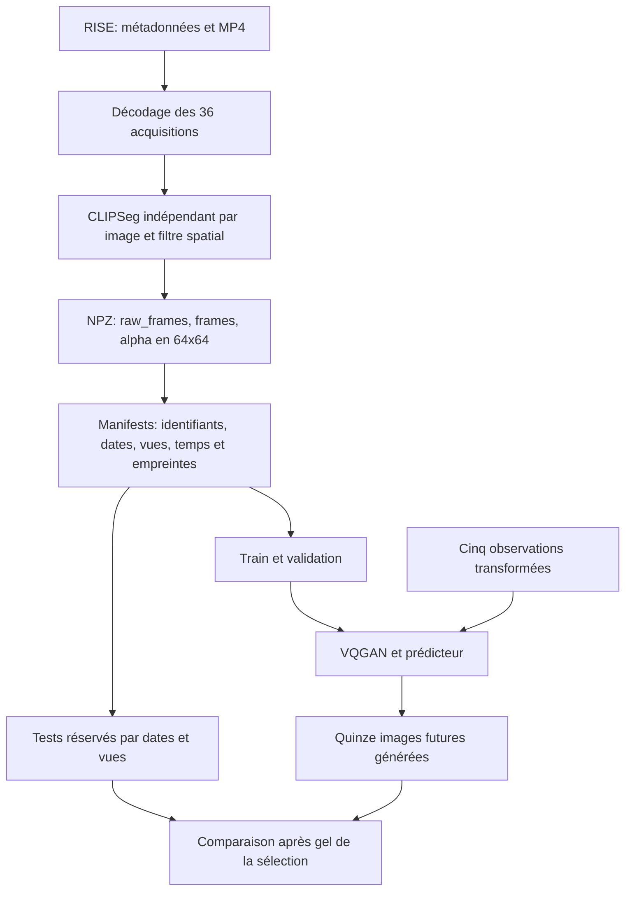
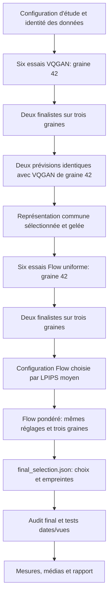
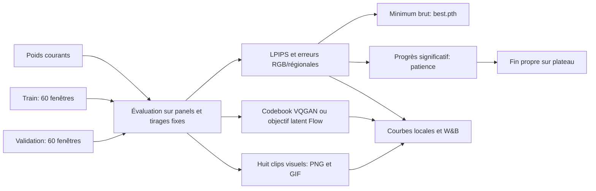
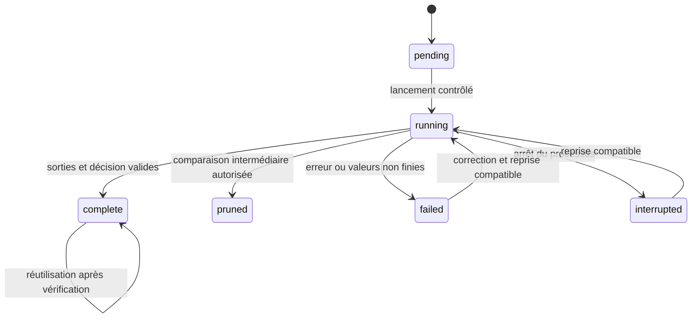

# Industrial Plume Forecasting — architecture

Le dépôt expose deux parcours : `study` compare des configurations selon un plan versionné ; `pipeline` exécute une recette fixe avec les références. Les commandes de préparation, d'inspection et d'évaluation restent disponibles séparément. Les données préparées sont réutilisables sans les vidéos sources.

## Données et absence de fuite temporelle

La segmentation d'une observation utilise seulement cette image et des poids/paramètres figés. Une autre image du clip ne doit modifier ni son RGB transformé ni son masque. Le générateur reçoit cinq observations et réutilise ensuite ses propres prédictions ; les vraies images futures et leurs masques servent uniquement à la mesure.

L'apprentissage Flow sélectionne une cible, sa référence précédente et une condition antérieure parmi les 36 images. Ce conditionnement temporel parcimonieux se distingue d'une perte directe sur quinze images futures. Le temps de transport de l'ODE se distingue des horodatages des acquisitions.

Les audits de recherche lisent train et validation. Les manifestes identifient les partitions réservées ; les pixels et résultats du test sont différés jusqu'au gel des choix. Les doublons exacts sont recherchés sur les RGB avant segmentation ; une forte similarité est signalée sans changement automatique de partition.

## Sélection progressive

Les phases comprennent au maximum douze entraînements VQGAN et dix-sept Flow. Les candidats croisent trois learning rates et deux schedulers. Les explorations et prévisions comparant les VQGAN ont un plafond de 15 000 mises à jour ; les confirmations et Flow pondérés de 50 000. Les graines de confirmation sont 17, 42 et 2026.

Optuna stocke les essais séquentiels dans SQLite. Son pruning médian compare seulement les explorations, après trois essais terminés et 7 500 mises à jour. Les confirmations sont indépendantes de ce pruning. Le choix de VQGAN utilise la prévision en validation, avec reconstruction moyenne comme départage. Le choix Flow utilise la moyenne des graines en validation. Les tests ne participent à aucune de ces décisions.

## Mesure et contrôle de l'entraînement

Les diagnostics restaurent les RNG et les modes des modules. Flow compare aussi l'objectif latent sur des tirages fixes indépendants ; la sélection reste fondée sur les images générées et décodées. Une réalisation est utilisée en exploration Flow, quatre en confirmation, pour les prévisions comparant les VQGAN et au test. Les réalisations sont toutes incluses dans la moyenne.

Dans l'étude, VQGAN valide toutes les 250 mises à jour avec patience 10 ; Flow toutes les 2 500 avec patience quatre. Le comptage débute à 5 000 mises à jour, avec `min_delta=1e-4`. Le minimum brut sélectionnant `best.pth` est distinct de l'amélioration significative qui remet la patience à zéro. L'arrêt anticipé ne prouve ni convergence globale ni absence de surapprentissage.

## États et reprise

Une fin par plafond ou arrêt anticipé est complète, avec motif explicite. Une interruption ne constitue pas une sélection finale. Les états Optuna et les états des runs sont reliés dans le registre sans confondre essai pruné et candidat confirmé.

La reprise exige les mêmes identités de code, données, paramètres et artefacts. Elle restaure optimiseurs, schedulers, RNG, patience et scaler AMP si activé. Un fine-tuning crée un autre run avec parent et réinitialisations déclarés.

## Artefacts et présentation

| Niveau | Artefacts |
|---|---|
| Étude | `study.json`, `optuna.sqlite3`, `experiments.csv`, `report.json`, `report.md` |
| Run | Protocole résolu, `effective_training.json`, métriques, diagnostics, médias, checkpoints |
| Décision | `final_selection.json` avec empreintes gelées avant test |
| Évaluation | Métriques par fenêtre/horizon/réalisation, durées, NFE, prédictions NPZ, médias |
| Campagne fixe | `pipeline.json`, protocole figé, logs et synthèse |
| Observateur | `campaign_monitor/status.json`, identité W&B, état de lecture et snapshot |

Le suivi W&B est optionnel ; les sorties locales restent disponibles. L'observateur de campagne lit les artefacts avec un verrou séparé, sans charger les tenseurs ni exécuter l'entraînement. Les vues sont séparées par méthode et accompagnées d'une définition des mesures. Les archives de test présentes indiquent une progression d'écriture, sans constituer un score final.

Pendant l'apprentissage, conserver deux checkpoints de récupération et le meilleur. Les médias récents, du meilleur checkpoint et finaux limitent l'accumulation. Après clôture, les finalistes conservent leurs états complets ; les autres essais gardent leurs poids sélectionnés et preuves expérimentales.

## Publication

Le dépôt contient code, configurations, protocole, références, tests et licences. Vidéos, NPZ, poids, caches, sessions W&B et résultats locaux restent exclus de Git. Une publication de résultats doit relier métriques, configurations et empreintes des artefacts, sans assimiler tests logiciels ou reconstruction d'images à une démonstration de qualité prédictive.
