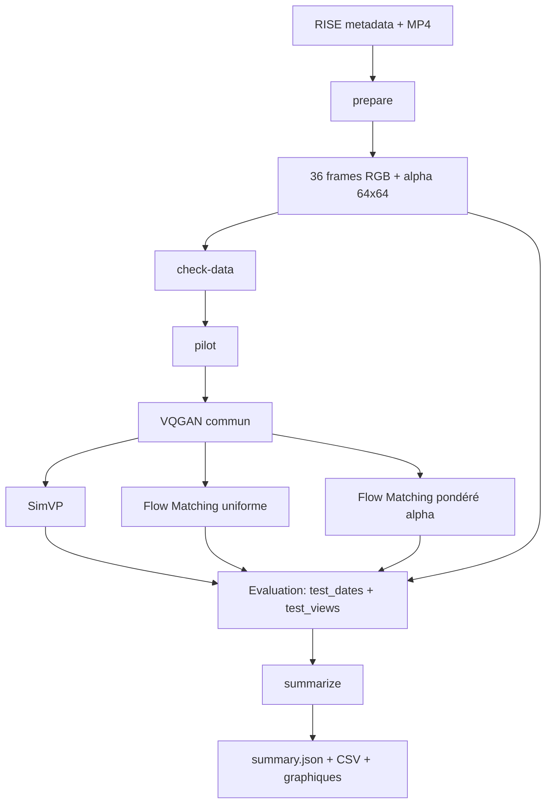
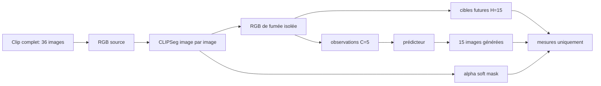
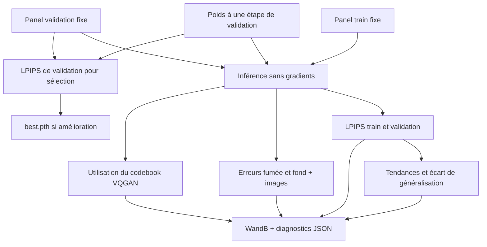
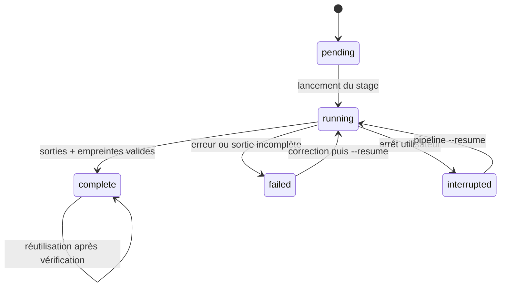

# Industrial Plume Forecasting — architecture

Ce document décrit les relations entre les données, les modèles et les artefacts. La commande `pipeline` est le point d'entrée canonique ; les commandes individuelles servent au diagnostic ou à la reprise ciblée.

## Vue d'ensemble

Chaque flèche représente une dépendance vérifiée par l'orchestrateur. Un stage ne peut pas être marqué terminé si son manifeste, son checkpoint ou ses métriques sont absents.

## Une fenêtre et l'absence de fuite

Pendant la génération, le prédicteur reçoit uniquement les cinq observations. Les quinze images futures et leurs masques sont utilisés après la génération pour la perte de validation ou les métriques de test ; ils ne sont jamais transmis à l'entrée du prédicteur.

## Monitoring et sélection

Les diagnostics ne modifient ni l'objectif d'entraînement ni le critère de sélection. Les états aléatoires et les modes des modules sont restaurés après l'inférence. Un écart train/validation ou une faible utilisation du codebook constitue un signal à examiner ; aucun de ces indicateurs ne prouve à lui seul un surapprentissage. Les ensembles de test restent réservés à l'évaluation finale.

## États de campagne

`pipeline.json` conserve l'état de chaque stage, la commande exécutée, le protocole, les chemins d'entrée et les empreintes des sorties. `protocol.yaml` est une copie figée de la configuration utilisée pour la campagne. Les logs sont dans `runs_scientific/<campagne>/logs/`.

## Dossiers publiables

Le dépôt contient le code, le protocole, la bibliographie, les tests et les notices de licence. Les vidéos, les données préparées, les poids CLIPSeg/LPIPS, les checkpoints, les sessions WandB et les sorties de campagne sont locales et ignorées par Git. Publier les métriques et les manifests d'une campagne séparément, après vérification de leur empreinte et de leur licence.
