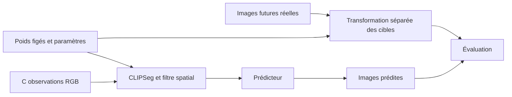

# Industrial Plume Forecasting — protocole expérimental

L'étude est définie dans `configs/experiment_study.yaml`, à partir de la configuration de modèle `configs/scientific_protocol.yaml`. Fixer les données, le scénario, les candidats et les règles de sélection avant leur exécution. Chaque run conserve ses paramètres résolus. Les résultats, y compris une absence d'amélioration, doivent rester traçables à leurs artefacts.

## 1. Questions et portée

1. Quel compromis entre qualité prédictive et coût de calcul offre le Flow Matching face à des références déterministes et apprises ?
2. Une pondération explicite des régions de fumée améliore-t-elle les prédictions ?

La tâche porte sur des images RGB de fumée isolée en deux dimensions. Elle ne valide pas une mesure de concentration, d'émissions ou de dynamique physique. Chaque clip conserve **36 acquisitions consécutives** en 64×64. La configuration de référence fixe **`C=5` observations et `H=15` images futures** ; le code accepte d'autres valeurs valides seulement pour une campagne explicitement distincte (`C≥2`, `H≥1`, `C+H≤36`).

Les travaux cités et leurs limites sont présentés dans [SCIENTIFIC_LITERATURE.md](SCIENTIFIC_LITERATURE.md), avec les entrées [BibTeX](references.bib).

## 2. Corpus et partitions

Utiliser le snapshot public RISE inclus dans `prepare_data/metadata_02242020.json` : 12 567 entrées, dont 5 025 satisfont le filtre positif. Ces nombres décrivent les métadonnées ; consigner séparément vidéos présentes, téléchargements réussis, exclusions et clips préparés.

Le filtre accepte une annotation positive `23` dans `label_state` ou `label_state_admin`, et rejette une annotation `-2`. Les partitions croisent les dates officielles S3 et les vues S0 de [RISE](https://github.com/CMU-CREATE-Lab/deep-smoke-machine#dataset). Les listes exactes sont versionnées dans `scientific/protocol.py`.

| Ensemble | Dates | Vues | Candidats dans les métadonnées |
|---|---|---|---:|
| Apprentissage | Dates d'apprentissage S3 | Vues d'apprentissage S0 | 1 673 |
| Validation | 22 janvier et 2 février 2019 | Vues d'apprentissage et de validation | 441 |
| Test dates | Dates futures de test S3 | Vues d'apprentissage | 706 |
| Test vues | Mêmes dates futures | Vues de test S0 | 328 |

Les vidéos, dates et vues réservées ne participent pas au VQGAN ni aux prédicteurs d'apprentissage. Réutiliser les mêmes modèles pour les deux ensembles de test. Aucun score de prédiction ne sert à décider l'inclusion d'un clip.

La sélection conserve tous les clips d'apprentissage, au plus 60 de validation et 200 par ensemble de test. Utiliser une sélection cyclique entre strates `(date, caméra, vue)`, ordonnée par empreinte avec graine 42. Publier les identifiants sélectionnés, les effectifs réellement exploitables et les motifs d'exclusion.

## 3. Temporalité et stockage

Décoder les MP4 dans l'ordre et vérifier le nombre d'images avec le conteneur. Conserver les indices 0 à 35 et les passages sans fumée. Une longueur différente reçoit `unexpected_clip_length` ; une incohérence de décodage reçoit un motif spécifique. Rejeter le clip entier, sans répétition d'image ni suppression d'acquisition intérieure.

Les temps sont provisoirement interpolés à partir des horodatages de début et de fin du nom source : `delta=(fin−début)/(N−1)`. Les indices doivent être consécutifs et les intervalles positifs constants. Cette interpolation est une hypothèse à vérifier sur le système d'acquisition ; présenter les horizons en images tant qu'elle n'est pas validée. La cadence MP4/GIF ne définit pas le temps physique.

Chaque NPZ contient :

| Champ | Forme | Type et rôle |
|---|---|---|
| `raw_frames` | `(36,64,64,3)` | RGB `uint8` avant extraction |
| `frames` | `(36,64,64,3)` | RGB `uint8`, produit source×masque sur fond noir |
| `alpha` | `(36,64,64)` | Masques souples flottants dans `[0,1]` |

Les vidéos originales restent les sources à leur résolution native. Les manifests conservent identifiant vidéo, caméra, vue, date, indices, horodatages, résolution source et SHA-256.

## 4. Segmentation causale

Utiliser `clipseg_guided` sur chaque image indépendamment :

1. Segmentation à la résolution source avec le préprocesseur officiel CLIPSeg. Son entrée réseau est de 352×352 ; aucune réduction préalable en 64×64.
2. Modèle figé `CIDAS/clipseg-rd64-refined`, révision `999e0328d9e10b484360c477313983f9afdd7050`. Vérifier le SHA-256 safetensors déclaré dans le YAML. Requêtes : `smoke`, `a chimney`, `factory buildings`.
3. Redimensionner les logits à la résolution source par interpolation bilinéaire, puis appliquer le sigmoid. Soit `s` le score smoke et `n` le maximum des scores négatifs. Exclure les structures où `n>0,60` et `n>s+0,10`.
4. Former `p=clip((s−0,10)/0,30,0,1)`, nul dans les régions exclues. Raffiner avec un filtre guidé par la luminance du RGB courant, rayon 4 pixels source, epsilon 0,001 et bords réfléchis. Utiliser les équations 5–8 de He et al. ; borner le résultat et réappliquer les exclusions.
5. Former le produit RGB×masque à la résolution source. Réduire ce produit et le masque séparément en 64×64 par interpolation d'aire. Borner à nouveau les masques après réduction pour absorber les erreurs d'arrondi. Aucun gain de luminosité ni lissage temporel.

Le champ `alpha` est un **masque sémantique estimé**, pas une annotation indépendante ni une opacité physique. La transformation des scores n'est pas une calibration d'opacité. Le produit peut conserver du fond visible à travers une fumée transparente. Les confusions entre fumée, vapeur, nuages et structures, ainsi que les variations temporelles des contours, font partie des limites à analyser.

Un modèle est chargé par préparation. Les conditions texte sont mises en cache et les activations visuelles sont partagées entre requêtes. Les lots de calcul ne mélangent pas les informations entre images. La taille de lot, le périphérique, les versions, la révision, les empreintes des fichiers du modèle et l'implémentation sont consignés. L'inférence utilise FP32 ; TF32 cuDNN est désactivé localement et les autres options sont restaurées après le calcul.

Une dépendance ou un poids absent arrête l'initialisation avant création des sorties. Une segmentation invalide conserve les RGB redimensionnés et le motif `segmentation_failed`, sans produire un masque de substitution.

Modifier une autre image du clip ne doit modifier ni une observation transformée ni son masque. Le générateur reçoit seulement les observations et n'a aucun accès aux futures images réelles ou à leurs masques.

## 5. Contrôles des données

`check-data` vérifie les empreintes, l'absence de chevauchement des identifiants vidéo, la continuité temporelle et le contenu de chaque clip sélectionné : formes, types RGB, masques finis et bornes. L'étude applique ses contrôles de recherche à train/validation puis diffère la lecture des pixels de test jusqu'au gel de la sélection. La commande générale `check-data` réalise un contrôle complet ; dans cette étude, l'utiliser après ce gel. Ces vérifications ne démontrent pas une précision de segmentation sur le corpus ; aucune IoU, Dice ou erreur d'alpha n'est revendiquée sans annotations indépendantes.

La spécification de préparation est indépendante de `C/H` et des paramètres des prédicteurs. Les pixels, partitions et paramètres de segmentation doivent correspondre au manifeste fourni.

## 6. Modèles et apprentissage

| Méthode | Rôle |
|---|---|
| Persistance | Répéter la dernière observation |
| Flot optique | Extrapoler le flot de Farnebäck des deux dernières observations |
| SimVP compact | Référence apprise directement sur RGB |
| Flow Matching uniforme | Méthode latente principale |
| Flow Matching pondéré | Ablation de la pondération par masque |

### VQGAN commun

Le VQGAN transforme les RGB 64×64×3 en latents 8×8×256. Son codebook contient 1 024 vecteurs, avec coefficient d'engagement 0,1 et canaux intermédiaires 128. Les dimensions de l'encodeur, du dictionnaire, du décodeur et du champ de vecteurs doivent correspondre. GroupNorm utilise le plus grand diviseur commun de 32 et du nombre de canaux.

L'objectif additionne MSE de reconstruction, LPIPS officiel AlexNet v0.1, perte VQ et terme adversarial hinge, de poids 1, 1, 1 et 0,1. Le discriminateur démarre après 1 000 mises à jour. Les deux optimiseurs sont AdamW, betas 0,9/0,999, epsilon 1e-8, décroissance 1e-6 et écrêtage de norme à 1. Seize images contribuent à chaque mise à jour par accumulation, selon un calendrier déterministe. La reconstruction utilise les 36 images disponibles ; la présentation visuelle conserve leur ordre.

La recette est une adaptation : elle ne reproduit pas la perte L1 et la pondération adversariale adaptative du VQGAN CompVis. La capacité et les poids des pertes restent constants dans la première recherche. Les origines et limites des paramètres figurent dans [TRAINING_DESIGN.md](TRAINING_DESIGN.md).

### Flow Matching temporel

Sur un clip d'apprentissage, tirer une cible `k∈{2,…,35}`, la référence `k−1` et une condition `j<k−1`, en indices Python. Le réseau reçoit le latent bruité, la référence, la condition, le temps de transport et la distance temporelle. Les images après la cible ne participent pas à cet exemple de perte. Cet apprentissage parcimonieux sur 36 images est distinct de l'évaluation autorégressive 5 → 15 ; il ne constitue pas une perte directe sur quinze cibles simultanées.

Avec bruit gaussien `eps`, temps `t∈[0,1]` et latent cible `z`, construire `z_t=[1−(1−sigma)t]eps+t z` et la vitesse `v=z−(1−sigma)eps`, avec `sigma=0,001`. Le temps de transport n'est pas le temps physique entre acquisitions. La représentation VQGAN reste gelée.

La variante uniforme minimise une MSE latente. La variante pondérée réduit le masque cible en 8×8 puis applique `w=5 alpha+1(1−alpha)`, normalisé par la moyenne spatiale de chaque cible. Le masque cible ne participe jamais à la génération. Le masque fondé sur la norme latente reste un diagnostic à confronter aux masques estimés.

La génération part des cinq observations puis réutilise ses propres images prédites. Elle produit quinze futurs avec RK4, une grille de 17 points et un RNG explicite. Enregistrer le nombre réel d'appels au réseau ; le nombre de points de grille ne suffit pas à le déduire pour toute implémentation.

### Références

SimVP compact utilise directement les RGB et une sous-séquence `C+H` tirée dans le clip. Son adaptation emploie 32 canaux spatiaux, 128 temporels, quatre blocs spatiaux et quatre temporels avec sortie tanh. Aucune reproduction des scores de l'article original n'est revendiquée. Persistance et Farnebäck complètent la comparaison à configuration fixe.

## 7. Étude des hyperparamètres

L'étude versionnée est définie dans `configs/experiment_study.yaml`. La commande `study` organise les entraînements séquentiels à partir des données préparées ; la commande `pipeline` reste disponible pour exécuter une configuration fixe. Les valeurs par défaut de `configs/scientific_protocol.yaml` ne remplacent pas les réglages résolus de l'étude.

### Candidats et paramètres constants

Chaque modèle compare le produit cartésien de trois learning rates (`5e-5`, `1e-4`, `2e-4`) et deux schedulers (constant, cosinus). Pour VQGAN, générateur et discriminateur partagent le learning rate. Pour Flow, l'échauffement linéaire dure 1 000 mises à jour. Le cosinus atteint 10 % du learning rate initial au plafond déclaré, même si un arrêt anticipé termine le run avant cette échéance.

Lot effectif 16, architecture, codebook, régularisation, poids des pertes et transformations des données restent fixés. Des espaces de recherche distincts pourront étudier capacité et pondérations ; leur modification exige une nouvelle étude. Six candidats ne démontrent pas une optimalité sur un espace continu ou sur toutes les architectures.

### Séquence de sélection

| Phase | Runs au maximum | Graines | Plafond par run | Réalisations Flow en validation |
|---|---:|---|---:|---:|
| Exploration VQGAN | 6 | 42 | 15 000 | Sans objet |
| Confirmation de deux VQGAN finalistes | 6 | 17, 42, 2026 | 50 000 | Sans objet |
| Prévision comparant les deux VQGAN | 2 | 42 | 15 000 | 4 |
| Exploration Flow uniforme | 6 | 42 | 15 000 | 1 |
| Confirmation de deux Flow finalistes | 6 | 17, 42, 2026 | 50 000 | 4 |
| Flow pondéré, réglages sélectionnés | 3 | 17, 42, 2026 | 50 000 | 4 |
| **Total** | **29** | | | |

Les six essais VQGAN sont classés par leur minimum de LPIPS de reconstruction en validation. Les deux configurations retenues sont entraînées depuis de nouvelles initialisations sur trois graines. Leur qualité de reconstruction moyenne est consignée. Les deux artefacts de graine 42 alimentent ensuite deux prévisions strictement identiques par leur recette Flow, leur graine et leur exposition maximale. Le VQGAN est choisi par la LPIPS de prévision ; une égalité est départagée par la reconstruction moyenne. Sa graine 42 fournit la représentation commune gelée. La variabilité de reconstruction entre graines est rapportée sans choisir a posteriori une graine favorable.

Le Flow uniforme est ensuite exploré avec ce VQGAN, puis ses deux configurations finalistes sont confirmées sur trois graines. Le choix repose sur la moyenne du LPIPS de validation des graines, avec un départage déterministe enregistré. La variante pondérée réutilise exactement les réglages retenus ; sa pondération 5/1 constitue l'ablation. Les modèles stochastiques incluent toutes leurs réalisations dans la moyenne, sans sélection du meilleur tirage.

### Pruning et arrêt anticipé

Optuna 4.6.0 conserve l'étude en SQLite. L'exécution est séquentielle. Le pruning médian ne s'applique qu'aux explorations, après trois essais terminés et au moins 7 500 mises à jour, en comparant les évaluations au même stade. Les confirmations et les deux prévisions comparant les VQGAN ne subissent pas ce pruning comparatif. Un essai pruné n'est pas un finaliste terminé ; son exposition et son motif restent visibles.

| Modèle dans l'étude | Validation | Patience | Début de comptage | Baisse significative |
|---|---:|---:|---:|---:|
| VQGAN | Toutes les 250 mises à jour | 10 validations | 5 000 mises à jour | Strictement plus de 0,0001 LPIPS |
| Flow | Toutes les 2 500 mises à jour | 4 validations | 5 000 mises à jour | Strictement plus de 0,0001 LPIPS |

`best.pth` conserve indépendamment le minimum brut, même si son amélioration est inférieure au seuil. La patience compare au dernier progrès significatif ; des gains infimes peuvent donc s'accumuler contre cette référence. Les décisions persistées distinguent `early_stopping`, plafond, pruning, interruption et échec. Publier les expositions réelles, qui peuvent différer malgré un même plafond.

Le pilote synthétique mesure mémoire et débit ; ses mesures ne constituent pas des résultats sur RISE. Une estimation de durée doit préciser le matériel, le coût des validations et les hypothèses de reprise.

## 8. Diagnostics et évaluation finale

### Panels et protection du test

Sélectionner de manière déterministe 60 fenêtres de diagnostic train et les 60 fenêtres de validation, avec huit exemples visuels par partition. Consigner identifiants, indices et graines des tirages. Les diagnostics préservent les RNG, modes des modules et paramètres. Les objectifs Flow utilisent des tirages fixes indépendants de l'apprentissage.

Avant sélection, l'audit lit les pixels et vérifie les empreintes de train et validation seulement. Il recherche des doublons exacts sur `raw_frames`, et signale les fortes similarités sans supprimer ni déplacer silencieusement une fenêtre. Les manifests de test peuvent identifier les partitions réservées ; leurs pixels, illustrations et scores ne doivent pas guider les décisions. L'audit complet des partitions de test intervient après gel des configurations et des artefacts. Une anomalie invalidant la séparation est rapportée ; une partition corrigée constitue une nouvelle version du dataset.

### Mesures et illustrations

Le critère principal est **LPIPS AlexNet v0.1**, moyenné sur les quinze horizons futurs pour la prévision. Rapporter aussi MSE, PSNR, SSIM, erreurs fumée/fond estimées, diversité MSE entre réalisations, temps, mémoire et appels réels au réseau. Les régions absentes restent manquantes et leur couverture est consignée.

VQGAN exporte RGB réel, reconstruction et erreur pour les 36 images. Flow identifie les cinq observations puis présente les quinze futurs réels et générés, avec erreurs. Les huit exemples fixés alimentent grilles PNG et GIF, sur train/validation pendant l'apprentissage et sur les tests après sélection. Les masques restent des estimations, sans vérité terrain indépendante.

Les graphiques montrent qualité train/validation, écarts, tendances, objectif Flow sur tirages fixes, codebook VQGAN, LR, gradients, valeurs non finies, temps, mémoire, meilleur checkpoint et patience. Le guide définit unités et limites. Un objectif latent qui diminue ne prouve pas une amélioration de la génération autorégressive. Ni une patience épuisée ni une faible LPIPS ne certifient l'absence de surapprentissage.

### Tests et incertitude

Après sélection figée, évaluer les mêmes fenêtres de `test_dates` et `test_views` pour toutes les méthodes. Flow utilise quatre réalisations par fenêtre ; les méthodes déterministes une seule. Les identifiants de graine des références ne créent pas des réalisations indépendantes.

Rapporter les horizons 1, 4, 8, 12 et 15, les courbes complètes, les différences appariées, la variabilité entre les trois graines et les intervalles à 95 % par bootstrap regroupé par journée, avec 2 000 réplications. Ne pas traiter les images d'une journée comme des observations indépendantes. Le nombre limité de journées de validation et les choix répétés sur ce panel restent des limites, conformément au biais de sélection décrit par [Cawley et Talbot](https://www.jmlr.org/beta/papers/v11/cawley10a.html).

La FVD reste une extension exigeant longueur de séquence, extracteur et effectifs justifiés. Aucune mesure d'image n'est présentée comme une validation physique du panache.

## 9. Artefacts et traçabilité

Chaque essai enregistre configuration résolue, graine, données, sources, versions, checkpoint parent éventuel, score, étape choisie, durée et état. SQLite, CSV et JSON conservent également les échecs, OOM, interruptions et essais prunés. La reprise exacte exige les mêmes identités et restaure optimiseurs, schedulers, RNG et scaler lorsque la précision mixte est activée.

Le fine-tuning crée un nouveau run et déclare `training.init_from` avec `path` et `reset`, l'empreinte parent et les composants réinitialisés : optimiseur, scheduler, RNG et arrêt anticipé. Pour un parent VQGAN sans état du discriminateur, sa réinitialisation doit aussi être explicite. Le fine-tuning ne transforme pas une reprise en changement discret de LR ou d'objectif et reste séparé des nouvelles initialisations de la comparaison principale. La sélection est gelée avant les tests.

Pendant l'apprentissage, conserver deux checkpoints de récupération et `best.pth` par remplacement atomique. Après clôture, conserver les poids sélectionnés et les preuves expérimentales ; les finalistes conservent leurs états complets. Les aperçus récents, ceux du meilleur checkpoint et les exports finaux sont conservés sans accumulation de tous les médias intermédiaires.

Les évaluations exportent une ligne par fenêtre, horizon et réalisation, les prédictions NPZ, empreintes, réglages et identifiants des modèles. L'agrégation rejette cellules manquantes, doublons et valeurs non finies. Analyser disparition, immobilité, apparition sur le fond et dérive temporelle, en conservant les résultats négatifs.

L'article suit introduction, travaux connexes, méthode, protocole, résultats, discussion et limites. Les tableaux et conclusions doivent provenir d'artefacts complets et identifiés. Les tests logiciels et les données synthétiques ne constituent pas des résultats scientifiques sur RISE.
