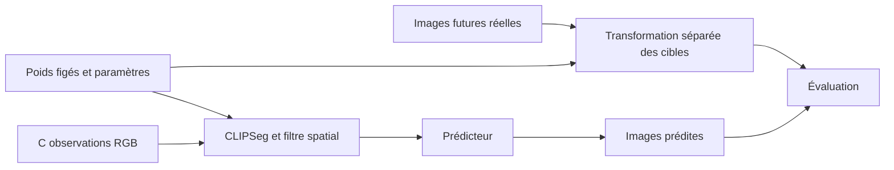

# Industrial Plume Forecasting — protocole expérimental

La configuration de référence est `configs/scientific_protocol.yaml`. Fixer les données, le scénario, les hyperparamètres et les règles de sélection avant la campagne. Les résultats, y compris une absence d'amélioration, doivent rester traçables à leurs artefacts.

## 1. Questions et portée

1. Quel compromis entre qualité prédictive et coût de calcul offre le Flow Matching face à des références déterministes et apprises ?
2. Une pondération explicite des régions de fumée améliore-t-elle les prédictions ?

La tâche porte sur des images RGB de fumée isolée en deux dimensions. Elle ne valide pas une mesure de concentration, d'émissions ou de dynamique physique. Chaque clip conserve **36 acquisitions consécutives** en 64×64. La configuration de référence fixe **`C=5` observations et `H=15` images futures** ; le code accepte d'autres valeurs valides seulement pour une campagne explicitement distincte (`C≥2`, `H≥1`, `C+H≤36`).

Les travaux cités et leurs limites sont présentés dans [SCIENTIFIC_LITERATURE.md](SCIENTIFIC_LITERATURE.md), avec les entrées [BibTeX](references.bib).

## 2. Corpus et partitions

Utiliser le snapshot public RISE inclus dans `prepare_data/metadata_02242020.json` : 12 567 entrées, dont 5 025 satisfont le filtre positif. Ces nombres décrivent les métadonnées ; consigner séparément vidéos présentes, téléchargements réussis, exclusions et clips préparés.

Le filtre accepte une annotation positive `23` dans `label_state` ou `label_state_admin`, et rejette une annotation `-2`. Les partitions croisent les dates officielles S3 et les vues S0 de [RISE](https://github.com/CMU-CREATE-Lab/deep-smoke-machine#dataset). Les listes exactes sont versionnées dans `scientific/protocol.py`.

| Ensemble | Dates | Vues | Candidats dans les métadonnées |
|---|---|---|---:|
| Apprentissage | Dates d'apprentissage S3 | Vues d'apprentissage S0 | 1 673 |
| Validation | 22 janvier et 2 février 2019 | Vues d'apprentissage et de validation | 441 |
| Test dates | Dates futures de test S3 | Vues d'apprentissage | 706 |
| Test vues | Mêmes dates futures | Vues de test S0 | 328 |

Les vidéos, dates et vues réservées ne participent pas au VQGAN ni aux prédicteurs d'apprentissage. Réutiliser les mêmes modèles pour les deux ensembles de test. Aucun score de prédiction ne sert à décider l'inclusion d'un clip.

La sélection conserve tous les clips d'apprentissage, au plus 60 de validation et 200 par ensemble de test. Utiliser une sélection cyclique entre strates `(date, caméra, vue)`, ordonnée par empreinte avec graine 42. Publier les identifiants sélectionnés, les effectifs réellement exploitables et les motifs d'exclusion.

## 3. Temporalité et stockage

Décoder les MP4 dans l'ordre et vérifier le nombre d'images avec le conteneur. Conserver les indices 0 à 35 et les passages sans fumée. Une longueur différente reçoit `unexpected_clip_length` ; une incohérence de décodage reçoit un motif spécifique. Rejeter le clip entier, sans répétition d'image ni suppression d'acquisition intérieure.

Les temps sont provisoirement interpolés à partir des horodatages de début et de fin du nom source : `delta=(fin−début)/(N−1)`. Les indices doivent être consécutifs et les intervalles positifs constants. Cette interpolation est une hypothèse à vérifier sur le système d'acquisition ; présenter les horizons en images tant qu'elle n'est pas validée. La cadence MP4/GIF ne définit pas le temps physique.

Chaque NPZ contient :

| Champ | Forme | Type et rôle |
|---|---|---|
| `raw_frames` | `(36,64,64,3)` | RGB `uint8` avant extraction |
| `frames` | `(36,64,64,3)` | RGB `uint8`, produit source×masque sur fond noir |
| `alpha` | `(36,64,64)` | Masques souples flottants dans `[0,1]` |

Les vidéos originales restent les sources à leur résolution native. Les manifests conservent identifiant vidéo, caméra, vue, date, indices, horodatages, résolution source et SHA-256.

## 4. Segmentation causale

Utiliser `clipseg_guided` sur chaque image indépendamment :

1. Segmentation à la résolution source avec le préprocesseur officiel CLIPSeg. Son entrée réseau est de 352×352 ; aucune réduction préalable en 64×64.
2. Modèle figé `CIDAS/clipseg-rd64-refined`, révision `999e0328d9e10b484360c477313983f9afdd7050`. Vérifier le SHA-256 safetensors déclaré dans le YAML. Requêtes : `smoke`, `a chimney`, `factory buildings`.
3. Redimensionner les logits à la résolution source par interpolation bilinéaire, puis appliquer le sigmoid. Soit `s` le score smoke et `n` le maximum des scores négatifs. Exclure les structures où `n>0,60` et `n>s+0,10`.
4. Former `p=clip((s−0,10)/0,30,0,1)`, nul dans les régions exclues. Raffiner avec un filtre guidé par la luminance du RGB courant, rayon 4 pixels source, epsilon 0,001 et bords réfléchis. Utiliser les équations 5–8 de He et al. ; borner le résultat et réappliquer les exclusions.
5. Former le produit RGB×masque à la résolution source. Réduire ce produit et le masque séparément en 64×64 par interpolation d'aire. Borner à nouveau les masques après réduction pour absorber les erreurs d'arrondi. Aucun gain de luminosité ni lissage temporel.

Le champ `alpha` est un **masque sémantique estimé**, pas une annotation indépendante ni une opacité physique. La transformation des scores n'est pas une calibration d'opacité. Le produit peut conserver du fond visible à travers une fumée transparente. Les confusions entre fumée, vapeur, nuages et structures, ainsi que les variations temporelles des contours, font partie des limites à analyser.

Un modèle est chargé par préparation. Les conditions texte sont mises en cache et les activations visuelles sont partagées entre requêtes. Les lots de calcul ne mélangent pas les informations entre images. La taille de lot, le périphérique, les versions, la révision, les empreintes des fichiers du modèle et l'implémentation sont consignés. L'inférence utilise FP32 ; TF32 cuDNN est désactivé localement et les autres options sont restaurées après le calcul.

Une dépendance ou un poids absent arrête l'initialisation avant création des sorties. Une segmentation invalide conserve les RGB redimensionnés et le motif `segmentation_failed`, sans produire un masque de substitution.

Modifier une autre image du clip ne doit modifier ni une observation transformée ni son masque. Le générateur reçoit seulement les observations et n'a aucun accès aux futures images réelles ou à leurs masques.

## 5. Contrôles des données

`check-data` vérifie les empreintes, l'absence de chevauchement des identifiants vidéo, la continuité temporelle et le contenu de chaque clip sélectionné : formes, types RGB, masques finis et bornes. L'entraînement et l'évaluation exigent la réussite de ces contrôles logiciels. Ceux-ci ne démontrent pas une précision de segmentation sur le corpus ; aucune IoU, Dice ou erreur d'alpha n'est revendiquée sans annotations indépendantes.

La spécification de préparation est indépendante de `C/H` et des paramètres des prédicteurs. Les pixels, partitions et paramètres de segmentation doivent correspondre au manifeste fourni.

## 6. Modèles et apprentissage

| Méthode | Rôle |
|---|---|
| Persistance | Répéter la dernière observation |
| Flot optique | Extrapoler le flot de Farnebäck des deux dernières observations |
| SimVP compact | Référence apprise directement sur RGB |
| Flow Matching uniforme | Méthode latente principale |
| Flow Matching pondéré | Ablation de la pondération par masque |

### VQGAN commun

Le VQGAN transforme les RGB 64×64×3 en latents 8×8×256. Son codebook contient 1 024 vecteurs, avec coefficient d'engagement 0,1 et canaux intermédiaires 128. Les paramètres déclarés dans le YAML définissent les fabriques. GroupNorm utilise le plus grand diviseur commun de 32 et du nombre de canaux.

Graine 42. Recette exploratoire déclarée dans `training.autoencoder` : MSE de reconstruction, LPIPS officiel AlexNet v0.1, perte VQ et terme adversarial hinge, de poids 1, 1, 1 et 0,1. Activer le discriminateur après la mise à jour 1 000. Deux optimiseurs AdamW à 2e-4 constants, betas 0,9/0,999, epsilon 1e-8, décroissance 1e-6 ; seize images par mise à jour par accumulation, choisies avec un calendrier déterministe. Validation toutes les 250 mises à jour et à la fin, écrêtage de norme à 1. Ces choix ne reproduisent pas exactement l'optimiseur et la perte adaptative du VQGAN CompVis.

Les origines des paramètres, leurs limites et une comparaison préenregistrée des LR sont détaillées dans [TRAINING_DESIGN.md](TRAINING_DESIGN.md). Le protocole de référence n'atteste pas leur optimalité. Séparer la calibration sur apprentissage/validation de la campagne confirmatoire ; figer les décisions avant toute consultation des tests. Chaque run exporte ses réglages effectifs dans `effective_training.json`.

Sélectionner le checkpoint par LPIPS de validation, puis geler le VQGAN commun à tous les prédicteurs latents. La variabilité de cet autoencodeur n'est pas répétée et doit être déclarée comme limite.

### RIVER / Flow Matching

Sur chaque clip d'apprentissage, tirer une cible `k∈{2,…,35}`, sa référence `k−1` et une condition `j<k−1` (indices Python). Le réseau reçoit le latent bruité, la référence, la condition, le temps de transport et la distance temporelle. Les images après la cible ne participent pas à son exemple de perte.

Avec bruit gaussien `eps`, temps `t∈[0,1]` et latent cible `z`, construire `z_t=[1−(1−sigma)t]eps+t z` et `v=z−(1−sigma)eps`, avec `sigma=0,001`. Le temps de transport ne représente pas les secondes entre acquisitions.

La perte uniforme est une MSE latente. Pour la pondération, réduire le masque cible en 8×8 puis calculer `w=5 alpha+1(1−alpha)`. Normaliser spatialement `w` par sa moyenne pour chaque cible avant de pondérer l'erreur ; modifier le micro-lot ne doit pas modifier cet objectif. Consigner la fraction du masque par norme latente comme diagnostic distinct.

Le Transformer utilise une dimension interne 512, six couches et deux couches intermédiaires. À l'évaluation, générer autorégressivement les `H` images avec RK4 : 17 points, soit 16 intervalles et normalement 64 appels au réseau par image. Exporter le nombre réel d'appels. Les tirages utilisent un générateur explicite.

### SimVP

L'adaptation compacte utilise 32 canaux spatiaux, 128 temporels, profondeur spatiale 4, profondeur temporelle 4 et sortie tanh. Elle apprend sur une sous-séquence de longueur `C+H` tirée dans le clip complet, puis génère par blocs de `C` jusqu'à `H`. Elle ne revendique pas la reproduction des scores de l'article SimVP.

### Plan commun

Trois graines pour chaque prédicteur : **17, 42, 2026**. Lot effectif seize par accumulation. AdamW, taux 1e-4, décroissance 5e-6 et échauffement linéaire 1 000 mises à jour, puis LR constant. Les paramètres communs ne s'appliquent pas au VQGAN. `training.max_updates` fixe le nombre commun, actuellement 100 000 ; cette limite d'exposition ne démontre pas une convergence. Sélection uniquement sur la validation.

Le pilote synthétique mesure mémoire et débit pour choisir un micro-lot parmi 4, 2 et 1. Il conserve le nombre configuré de mises à jour. Ses résultats ne sont pas des mesures de qualité prédictive. Les checkpoints conservent poids, optimiseurs, scheduler, RNG et provenance. La reprise exige les mêmes sources, données, configuration et artefacts. Documenter les entraînements incomplets.

### Diagnostics de généralisation

À chaque validation, comparer le LPIPS avec un panel fixe d'apprentissage en mode évaluation : jusqu'à 60 clips pour le VQGAN et 8 pour les prédicteurs. Le nombre d'images, les identifiants et les indices sont exportés. Consigner l'écart train/validation, MSE fumée/fond, référence triviale noire ou par persistance, résultats par date et vue, et utilisation du codebook globale et dans les régions de fumée. Les pseudo-masques ne constituent pas une vérité terrain indépendante.

Les diagnostics préservent les états aléatoires, les modes des modules et les paramètres. Le choix des images de validation, les tirages de génération et la moyenne LPIPS utilisés pour sélectionner le checkpoint restent identiques. Les diagnostics complémentaires ne deviennent pas un nouveau critère de sélection après observation des résultats.

Un signal descriptif de surapprentissage possible repose sur cinq validations successives : pente négative du LPIPS du panel d'apprentissage, pente positive du LPIPS de validation, et score courant supérieur de plus de 10 % au meilleur score. Ce signal ne déclenche aucun arrêt automatique et n'est pas une preuve statistique. La sélection répétée sur un panel fini peut elle-même introduire un biais ; l'évaluation finale reste réservée aux tests indépendants.

## 7. Évaluation

Critère principal : **LPIPS AlexNet v0.1**, moyenné sur tous les horizons futurs. Produire quatre réalisations par clip pour Flow Matching et les inclure toutes, sans choisir la meilleure. Les références déterministes ont une seule réalisation ; leurs identifiants de graine servent à conserver les clés des comparaisons appariées.

Rapporter MSE, PSNR, SSIM, erreurs dans les régions fumée/fond estimées, diversité MSE entre réalisations, temps de génération, mémoire et nombre d'appels au réseau. Les régions sont définies par les pseudo-masques ; leurs erreurs ne sont pas une validation physique. Exporter les courbes selon l'horizon et choisir les horizons des tableaux avant de consulter le test.

Utiliser les mêmes panels fixés pour toutes les méthodes. Rapporter différences appariées, moyennes par graine, variabilité entre graines et intervalles à 95 % par bootstrap regroupé par journée, avec 2 000 réplications. Ne pas traiter les images d'une même journée comme des observations indépendantes.

La FVD reste une extension exigeant une longueur de séquence, un extracteur et des effectifs justifiés. Elle n'est pas un critère central de cette campagne.

## 8. Artefacts et analyse

Chaque réalisation exporte les prédictions NPZ et une empreinte ; chaque ligne de métrique identifie méthode, graine, clip, horizon et réalisation. Les fichiers d'évaluation relient configuration, données, checkpoint et poids LPIPS. L'agrégation rejette grilles incomplètes, doublons, valeurs non finies et métriques factices injectées par les tests.

Analyser disparition du panache, immobilité, apparition sur le fond et dérive temporelle. Fixer les exemples qualitatifs avant la mesure et ajouter des cas d'échec représentatifs. Préserver les résultats négatifs et distinguer non-convergence, défaut de données et limites de modèle.

L'article suit : introduction, travaux connexes, méthode, protocole, résultats, discussion et limites. Les tableaux et conclusions doivent provenir des artefacts vérifiés. Ne pas annoncer une supériorité, une nouveauté ou une validité physique qui n'a pas été démontrée.
