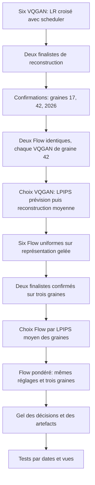

# Industrial Plume Forecasting — paramètres et lecture des résultats

Les choix d'entraînement sont des hypothèses explicites comparées sur validation. Une configuration peut être meilleure parmi les candidats examinés sans être optimale pour toute architecture, exposition ou partition. La reconstruction VQGAN et la prévision Flow répondent à deux questions distinctes.

## Pourquoi cette comparaison

La première recherche fait varier deux facteurs : le learning rate et sa décroissance. Les trois LR `5e-5`, `1e-4` et `2e-4` encadrent une plage locale d'un facteur quatre ; ils ne sont pas des constantes universelles pour la fumée. Leur croisement avec scheduler constant/cosinus forme six candidats interprétables. Le LR VQGAN règle ensemble générateur et discriminateur ; l'étude ne mesure pas le meilleur rapport entre les deux.

Le scheduler constant isole la capacité d'un LR fixe. Le cosinus réduit progressivement son amplitude jusqu'à 10 % de la valeur initiale au plafond prévu. Un arrêt anticipé peut terminer le run avant d'atteindre ce plancher. Flow utilise au préalable 1 000 mises à jour d'échauffement linéaire. Les paramètres effectivement exécutés sont exportés dans `effective_training.json` et reliés à la configuration résolue.

Optuna 4.6.0 fournit stockage SQLite, essais et pruning. Les six configurations sont déclarées avant les entraînements ; ce petit plan ne justifie pas une revendication d'optimisation bayésienne exhaustive. L'exécution séquentielle évite l'interférence des jobs sur le GPU et facilite la reprise. Voir les documentations officielles sur [persistance et reproductibilité](https://optuna.readthedocs.io/en/v4.6.0/faq.html) et [MedianPruner](https://optuna.readthedocs.io/en/v4.6.0/reference/generated/optuna.pruners.MedianPruner.html).

## Paramètres conservés et leur rôle

| Paramètre | Valeur de l'étude | Signification et limite |
|---|---|---|
| Géométrie | 36 images stockées, 64×64 RGB | Conserve début, milieu et fin du clip, même sans fumée ; résolution visuelle limitée. |
| Évaluation | 5 observations → 15 futurs | Scénario de prévision fixé ; l'horizon est exprimé en images, sans déduire les secondes de la cadence GIF. |
| Lot effectif | 16 par accumulation | Nombre de contributions avant une mise à jour ; micro-lot ajusté à la mémoire, sans changer l'objectif. |
| Latents VQGAN | 8×8×256 | Compression spatiale ; dimensions encodeur, codebook, décodeur et Flow couplées. |
| Codebook | 1 024 codes, engagement 0,1 | Capacité discrète et force du rappel de l'encodeur vers les codes ; occupation observée, sans optimisation de capacité dans cette étude. |
| Canaux VQGAN | 128 | Capacité des blocs convolutionnels, tenue constante pour isoler LR et scheduler. |
| VQGAN : reconstruction / LPIPS / VQ / adversarial | 1 / 1 / 1 / 0,1 | Compromis pixels, perception, quantification et réalisme ; amplitudes des termes non comparables. |
| Démarrage discriminateur | Après 1 000 mises à jour | Phase initiale sans terme adversarial actif ; cette transition peut rendre les courbes plus bruitées. |
| AdamW | Betas 0,9/0,999, epsilon 1e-8 | Mémoire des moments et stabilisation numérique ; conservés pendant cette recherche. |
| Weight decay | VQGAN 1e-6 ; Flow 5e-6 | Régularisation de l'optimiseur, distincte du LR et de la perte VQ. |
| Écrêtage des gradients | Norme 1 | Limite une mise à jour excessive ; journaliser la norme avant écrêtage. |
| Champ de vecteurs | Largeur 512, profondeur 6 et milieu 2 | Capacité du Transformer ; architecture constante, sans preuve qu'elle soit minimale ou optimale. |
| Flow `sigma` | 0,001 | Bruit résiduel du chemin de transport, distinct des intervalles entre acquisitions. |
| Pondération `flow_alpha` | Fumée 5, fond 1, normalisée par cible | Ablation du poids régional ; masque estimé CLIPSeg, sans annotation indépendante. |
| Solveur | RK4, grille de 17 points | Approximation de la génération latente ; journaliser les appels réels au réseau. |
| Précision | FP32 par défaut ; AMP explicite | La précision mixte est une option d'expérience, avec scaler sauvegardé ; elle n'est pas activée silencieusement. |

Le [VQGAN CompVis](https://github.com/CompVis/taming-transformers/blob/master/taming/models/vqgan.py) utilise Adam avec betas 0,5/0,9. Sa [perte de référence](https://github.com/CompVis/taming-transformers/blob/master/taming/modules/losses/vqperceptual.py) combine notamment L1, LPIPS et poids adversarial adaptatif. La présente recette utilise MSE, AdamW et poids adversarial fixe ; elle ne revendique pas une reproduction exacte.

Le LR `1e-4` et le weight decay `5e-6` des prédicteurs ont notamment un précédent dans la [configuration BAIR 64 de RIVER](https://github.com/araachie/river/blob/main/configs/bair_64.yaml). Ce précédent ne les valide pas sur la fumée. L'étude compare leurs alternatives en contrôlant les autres facteurs. La représentation, l'initialisation et le scheduler peuvent différer des expériences publiées.

## Étapes et règles de sélection

Les six essais initiaux de chaque modèle utilisent la graine 42 et un plafond de 15 000 mises à jour. Les deux finalistes de chaque modèle repartent de nouvelles initialisations, avec graines 17, 42 et 2026 et plafond 50 000. Les deux prévisions comparant les VQGAN ont un plafond de 15 000. La variante pondérée utilise 50 000. L'ensemble comprend au maximum 29 entraînements ; ce nombre inclut les confirmations.

La confirmation VQGAN mesure la variabilité de reconstruction. Ses deux artefacts de graine 42 sont comparés par la même recette Flow, avec les mêmes graines de génération. Le choix final de VQGAN dépend de la prévision en validation ; sa reconstruction moyenne départage une égalité. Choisir une graine VQGAN a posteriori en fonction du meilleur score introduirait un facteur supplémentaire ; la représentation commune utilise la graine fixée 42.

Flow est d'abord réglé en perte uniforme. Les deux finalistes sont départagés par la moyenne de leur LPIPS de validation sur les trois graines ; la variance reste rapportée. Réutiliser les mêmes réglages pour la variante pondérée isole son effet. Les tirages de validation sont fixés, avec une réalisation en exploration et quatre en confirmation, dans les comparaisons VQGAN par prévision et au test. Toutes sont moyennées, sans meilleur tirage sélectionné.

Le pruning médian commence après trois essais terminés et 7 500 mises à jour ; il compare des scores au même stade. Il ne s'applique pas aux confirmations ni aux deux prévisions comparant les VQGAN. Un candidat pruné peut être un apprenant tardif : conserver sa courbe, sa durée et son motif de fin. La confirmation complète des finalistes réduit cette limite sans l'annuler.

## Interprétation des graphiques

L'axe `global_step` compte les mises à jour de l'optimiseur. Les graphiques de qualité ne sont pas lissés. Une perte de mini-lot fluctue avec les images ; les panneaux de diagnostic utilisent des exemples et tirages fixes en mode évaluation.

| Série | Unité / sens | Lecture utile et limite |
|---|---|---|
| `train_eval/lpips`, `validation/lpips` | Distance perceptuelle, ↓ | Même métrique sur panneaux distincts ; aucune valeur universelle ne garantit un bon panache. |
| `train_eval/objective`, `validation/objective` | Erreur de vitesse latente Flow, ↓ | Tirages fixes indépendants de l'apprentissage ; une baisse ne garantit pas quinze images futures cohérentes. |
| `train/loss` | Objectif de mini-lot | Suit l'optimisation ; ne se compare pas directement à LPIPS ni entre pondérations différentes. |
| `generalization/lpips_gap` | Validation − apprentissage | Un écart croissant demande examen ; les différences de dates ou de vues contribuent aussi à cet écart. |
| MSE / PSNR / SSIM | RGB [0,1] ; ↓ / dB ↑ / ↑ | Complètent LPIPS ; une grande surface noire peut rendre les mesures globales favorables. |
| `validation/smoke_mse` | MSE dans le masque estimé, ↓ | Pixels où alpha ≥0,1 ; régions absentes exclues, couverture et effectifs rapportés. |
| `validation/background_mse` | MSE du fond estimé, ↓ | Une faible erreur sur fond noir ne démontre pas que le volume de fumée est conservé. |
| `train/reconstruction` | MSE RGB dans [-1,1] | À pixels et écrêtage identiques, vaut quatre fois la MSE dans [0,1] ; mini-lots et panels diffèrent. |
| `train/perceptual`, `train/vq` | Composantes de perte | Leurs amplitudes n'ont pas la même interprétation ; lire avec codebook et images. |
| `train/generator`, `train/discriminator` | Objectifs adversariaux | Pas des taux d'exactitude ; une perte D proche de 1 ne démontre pas l'équilibre. |
| Perplexité du codebook | exp(entropie), entre 1 et K | Diversité d'assignation sur le panel ; sa maximisation n'est pas un objectif scientifique. |
| Fraction des codes utilisés | Codes actifs / K | Dépend du nombre d'assignations ; examiner global et régions de fumée. |
| LR générateur / discriminateur / Flow | Taux d'apprentissage | Vérifie le scheduler réellement exécuté ; une courbe plate est attendue pour le candidat constant. |
| Norme des gradients | Avant écrêtage | Pics ou écrêtage récurrent demandent examen ; une faible norme ne prouve pas une bonne représentation. |
| Pentes LPIPS | Variation par 1 000 mises à jour | Régression sur cinq validations : négative = erreur en baisse, positive = en hausse ; tendance locale sensible au bruit. |
| Patience consommée / seuil | Nombre de validations | Approche du déclenchement d'arrêt, distincte de l'étape du meilleur checkpoint. |
| Temps / mémoire / NFE | Secondes / octets / appels réseau | Coût du calcul ; NFE réel exporté pour les générations. |
| Diversité | MSE entre réalisations | Différences entre tirages ; diversité élevée seule ne démontre pas une bonne prévision. |

Les grilles VQGAN montrent original, reconstruction et erreur sur 36 images. Les grilles Flow identifient les cinq observations puis quinze futurs réels et générés ; les GIF suivent toute la séquence. Huit identifiants fixes sont réservés aux illustrations par partition. Les masques complémentaires restent des estimations sémantiques. La vitesse de lecture d'une animation ne remplace pas les horodatages des acquisitions.

## Arrêt anticipé et surapprentissage

Dans l'étude, VQGAN valide toutes les 250 mises à jour avec patience 10 ; Flow toutes les 2 500 avec patience quatre. Le comptage commence après 5 000 mises à jour et la phase initiale. Une amélioration doit dépasser strictement `1e-4` LPIPS par rapport au dernier progrès significatif. De petits gains peuvent s'accumuler contre cette référence ; une égalité ne remet pas le compteur à zéro.

Le minimum brut sélectionnant `best.pth` est indépendant de `min_delta`. Une légère amélioration peut donc changer le checkpoint sans réinitialiser la patience. Les états et décisions sont persistés ; publier exposition réelle, meilleur score, meilleur step, score final et motif de fin. Les différences d'exposition dues au pruning ou à l'arrêt doivent rester visibles.

La règle de référence de la commande `pipeline` est définie séparément dans `configs/scientific_protocol.yaml`. Modifier les réglages de l'étude ne modifie pas silencieusement ceux d'une campagne à configuration fixe ou d'une reprise.

Une validation qui monte tandis que le train baisse peut signaler un surapprentissage, une distribution différente ou du bruit. Le drapeau `generalization/possible_overfit` reste une heuristique descriptive sur cinq validations et une dégradation supérieure à 10 % ; il ne commande pas l'arrêt et son absence ne certifie rien. Les courbes affichent les pentes numériques pour permettre leur lecture.

Les deux journées de validation et le panel de 60 fenêtres limitent la généralisation mesurable. Des choix répétés sur un échantillon fini peuvent suradapter la sélection elle-même, comme l'analysent [Cawley et Talbot, 2010](https://www.jmlr.org/beta/papers/v11/cawley10a.html). Les tests ne servent ni au LR, ni à la patience, ni à la sélection d'une graine ou d'un exemple d'entraînement.

## Traçabilité et conclusions

Conserver tous les essais, leurs configurations, graines, données, sources, versions, durées et motifs d'arrêt dans SQLite, CSV et JSON. `final_selection.json` relie les artefacts retenus avant ouverture du test. Les audits vérifient les empreintes, partitions et doublons ; ils ne prouvent pas la justesse des pseudo-masques.

La reprise exacte restaure états d'optimiseur, scheduler, RNG et scaler si activé. Un fine-tuning utilise un nouveau run, un parent identifié et les composants réinitialisés déclarés. La comparaison principale démarre depuis de nouvelles initialisations contrôlées.

Après gel, présenter mêmes fenêtres de test, quatre réalisations Flow, résultats par horizon, trois graines et bootstrap regroupé par journée. Les conclusions restent proportionnées aux mesures : un résultat négatif, un plateau ou un échec conservé contribue à l'étude ; une reconstruction favorable ne suffit pas à valider la prévision.
