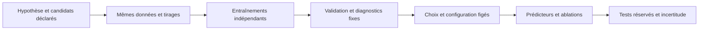

# Industrial Plume Forecasting — apprentissage et suivi

Les valeurs de référence sont des **réglages exploratoires**, pas des hyperparamètres optimaux démontrés sur RISE. Une configuration explicite rend une expérience reproductible ; une comparaison contrôlée sur validation est nécessaire pour justifier son choix. La reconstruction VQGAN et la prédiction vidéo sont deux tâches distinctes.

## Origine et rôle des réglages

`configs/scientific_protocol.yaml` distingue `training.autoencoder` des paramètres communs aux prédicteurs. Chaque entraînement exporte les valeurs résolues dans `effective_training.json` et, si activé, dans la configuration W&B `effective_training`.

| Réglage | VQGAN de référence | Rôle et justification actuelle |
| --- | --- | --- |
| Optimiseur | AdamW, betas 0,9 / 0,999, epsilon 1e-8 | Recette locale ; ces paramètres ne reproduisent pas l'optimiseur du VQGAN original. |
| LR générateur / discriminateur | 2e-4 / 2e-4 | Valeurs initiales locales, à comparer sur la fumée. Deux LR sont déclarés séparément. |
| Décroissance des poids | 1e-6 | Régularisation exploratoire ; une faible décroissance ne garantit pas l'absence de surapprentissage. |
| Évolution du LR | Constant | Aucun échauffement des prédicteurs n'est appliqué au VQGAN. Une autre politique exigerait une expérience distincte et son implémentation. |
| Lot effectif | 16 images | Accumulation de seize images, une par clip tiré ; la taille du lot ne représente pas seize clips complets traités comme des vidéos par le VQGAN. |
| Perte générateur | 1×MSE + 1×LPIPS + 1×VQ + 0,1×adversarial | Pondérations locales fixes. L'adversarial vaut −moyenne du discriminateur sur les reconstructions. Aucun poids régional fumée/fond dans cette perte. |
| Début du discriminateur | Après 1 000 mises à jour | Préapprentissage local de reconstruction ; ce seuil n'a pas été calibré sur RISE. |
| Écrêtage des gradients | Norme maximale 1 | Protection numérique ; la norme avant écrêtage est enregistrée. Ce n'est pas une régularisation validée. |
| Validation | Toutes les 250 mises à jour et à la fin | Panel fixe, fréquence identique entre candidats. Plus de validations implique aussi plus de consultations du même panel. |
| Représentation | Latents 8×8×256, 1 024 codes, engagement 0,1 | Capacité fixée pour l'étude initiale ; utilisation mesurée, capacité non optimisée. |
| Graine | 42 | Même initialisation et même calendrier d'échantillonnage pour comparer les recettes ; variabilité VQGAN entre graines non évaluée. |

Pour les prédicteurs, AdamW utilise LR 1e-4, décroissance 5e-6, betas 0,9/0,999 et epsilon 1e-8. LR et décroissance correspondent notamment à la [configuration BAIR 64 de RIVER](https://github.com/Araachie/river/blob/main/configs/bair_64.yaml). Ce précédent ne démontre pas leur adéquation à la fumée : BAIR utilise un autoencodeur préentraîné différent et 5 000 mises à jour d'échauffement. Le [trainer RIVER](https://github.com/Araachie/river/blob/main/training/trainer.py) emploie ensuite une décroissance polynomiale ; le présent code utilise 1 000 mises à jour d'échauffement linéaire, puis un LR constant. SimVP compact partage cette recette locale, sans reproduction revendiquée de son entraînement original.

Le [VQGAN CompVis](https://github.com/CompVis/taming-transformers/blob/master/taming/models/vqgan.py) utilise Adam avec betas 0,5/0,9. Sa [perte de référence](https://github.com/CompVis/taming-transformers/blob/master/taming/modules/losses/vqperceptual.py) associe notamment erreur L1, LPIPS et pondération adversariale adaptative par normes de gradients. Le présent VQGAN est une adaptation avec MSE et poids adversarial fixe. Un LR de base d'un autre dépôt ne se compare pas directement : CompVis le [multiplie par le lot, le nombre de GPU et l'accumulation](https://github.com/CompVis/taming-transformers/blob/master/main.py).

La pondération 5/1 intervient seulement dans `flow_alpha`, normalisée par la moyenne des poids de chaque cible. `sigma=0,001`, l'architecture du Transformer, le dictionnaire et les seuils CLIPSeg sont également des hypothèses fixées, non des valeurs optimales établies. Les faire varier simultanément empêcherait d'attribuer un effet à un facteur précis.

## Comparaison contrôlée des taux d'apprentissage

La première calibration compare un **facteur couplé** : LR générateur et discriminateur prennent ensemble 5e-5, 1e-4 ou 2e-4. Elle n'identifie pas le meilleur rapport entre leurs LR. Cet intervalle encadre le réglage initial ; il ne constitue pas une plage universelle.

Préenregistrer le nombre commun de mises à jour, les candidats, la graine, les partitions et la règle de sélection avant leur exécution. Le générateur de plan prépare des configurations et des commandes ; il ne lance aucun entraînement et ne lit aucun score de test :

```bash
python tools/plan_calibration.py \
  --data scientific_data/smoke \
  --output runs_scientific/calibration_vqgan_lr \
  --learning-rates 0.00005 0.0001 0.0002 \
  --updates 15000
```

Les 15 000 mises à jour sont une durée d'exposition exploratoire déclarée, incluant la phase adversariale ; elles ne prouvent pas une convergence. Chaque candidat voit 240 000 tirages d'images avec remise selon le même calendrier déterministe. Ce nombre ne mesure ni les images uniques ni des époques complètes.

Le générateur de calibration désactive explicitement l'arrêt anticipé pour ces candidats : leur exposition doit rester identique. Cette exception au protocole de campagne est enregistrée dans chaque YAML et dans ses réglages effectifs.

Les sorties sont `candidate_*.yaml`, `study.json` et `commands.sh`. Le plan enregistre les empreintes du dataset, des sources et du générateur de plan, ainsi que l'interpréteur et les versions des principales dépendances. Les commandes utilisent cet interpréteur. Comparer ces identités avec la provenance des runs avant analyse ; le script de lancement ne verrouille pas le système de fichiers ni l'environnement entre-temps. Chaque candidat possède son propre dossier de campagne et son propre run W&B. L'exécution, lorsqu'elle est décidée, est séquentielle :

```bash
bash runs_scientific/calibration_vqgan_lr/commands.sh
```

Règle préenregistrée : parmi les candidats ayant terminé le même nombre de mises à jour, retenir celui dont le meilleur checkpoint possède la plus faible LPIPS de validation. Une égalité exacte favorise le plus petit LR. Publier les courbes complètes, le score final, le meilleur score et son étape, les erreurs régionales, l'occupation du codebook et les essais interrompus. Un essai avec des valeurs non finies ne constitue pas un candidat terminé. Les diagnostics secondaires expliquent les échecs ; ils ne remplacent pas discrètement le critère principal après examen des scores.

Un LR plus petit peut nécessiter davantage de mises à jour : le classement porte sur l'exposition choisie, pas sur une qualité asymptotique garantie. Toute prolongation ou modification du critère devient une nouvelle étude déclarée, avec tous les essais conservés. Une faible occupation du codebook ou une LPIPS globale favorable sur des images noires justifie une analyse explicite des images avec fumée.

Une fois la recette VQGAN choisie, figer son artefact pour les prédicteurs. Calibrer ensuite leur LR à données, graines et durée identiques, puis isoler la comparaison `flow_uniform` / `flow_alpha`. La calibration d'un LR ne valide pas les autres hyperparamètres. Les seuils, architectures ou poids supplémentaires nécessitent des ablations distinctes si une conclusion dépend d'eux.



## Ce que représentent les graphiques

L'axe `global_step` compte les mises à jour de l'optimiseur. Les courbes de qualité sont sans lissage. Les pertes de mini-lot varient avec les images ; elles ne se comparent pas directement aux mesures sur les panels fixes.

| Mesure | Unité / sens | Lecture utile et limites |
| --- | --- | --- |
| `train_eval/lpips`, `validation/lpips` | Distance perceptuelle, ↓ | Même métrique en mode évaluation. Une baisse de validation soutient un progrès sur ce panel ; aucun seuil universel ne certifie la qualité. |
| `generalization/lpips_gap` | LPIPS validation − apprentissage | Une augmentation durable demande l'examen des courbes et des strates. L'écart dépend aussi des distributions des deux ensembles. |
| `validation/smoke_mse` | MSE RGB dans [0,1], ↓ | Seulement les pixels dont alpha estimé ≥0,1 ; images sans région correspondante exclues. Rapporter les effectifs valides et la fraction de fumée. |
| `validation/background_mse` | MSE RGB dans [0,1], ↓ | Peut être très faible si le fond est presque noir. Ne démontre pas la conservation du panache. |
| `train/reconstruction` | MSE RGB dans [-1,1], ↓ | À pixels identiques et sans différence d'écrêtage, vaut quatre fois la MSE dans [0,1]. Les panels et mini-lots diffèrent également. |
| `train/perceptual`, `train/vq` | Termes distincts de l'objectif | Interpréter avec reconstruction, codebook et images ; leurs amplitudes ne mesurent pas la même chose. |
| `train/generator`, `train/discriminator` | Objectifs adversariaux | Pas des taux d'exactitude. Une perte discriminateur proche de 1 ne prouve pas un équilibre ; la perte générateur peut être négative et non monotone. |
| Perplexité du codebook | exp(entropie), entre 1 et K si non vide | Nombre effectif de codes utilisés sur le panel. Comparer surtout global/fumée et évolution, sans chercher systématiquement à la maximiser. |
| Fraction des codes utilisés | Codes actifs / K, dans [0,1] | Dépend du nombre d'assignations N : au plus min(K,N) codes observables. Une image presque noire favorise certains codes. |
| `train/gradient_norm_before_clip` | Norme avant écrêtage | Pics ou écrêtage récurrent signalent un examen numérique ; une norme faible ne certifie pas une bonne représentation. |
| Temps / mémoire | Secondes par mise à jour / octets | Décrit le calcul, pas la qualité ni la généralisation. |
| LPIPS par date et vue | Même distance, ↓ | Repère une moyenne globale masquant une strate difficile. Rapporter les effectifs ; une seule image n'est pas une estimation robuste. |

Les colonnes visuelles sont RGB réel, reconstruction/prédiction, erreur absolue et masque estimé. Le masque reste une estimation CLIPSeg, sans vérité terrain indépendante. Les compteurs restent disponibles dans les fichiers de diagnostics et l'historique W&B, même sans graphique individuel.

## Surapprentissage et sélection

### Arrêt sur plateau de validation

La campagne de référence utilise la même politique pour le VQGAN, SimVP et les deux variantes Flow Matching :

```yaml
training:
  max_updates: 100000
  early_stopping:
    enabled: true
    patience: 10
    min_delta: 0.0001
    min_updates: 5000
```

La patience compte des validations, pas des mises à jour. Avant 5 000 mises à jour, le compteur reste nul ; il reste également nul avant la fin de l'échauffement des prédicteurs et avant l'activation du discriminateur VQGAN. Une amélioration doit dépasser strictement 0,0001 LPIPS par rapport à la dernière amélioration significative. De petits gains peuvent s'accumuler contre cette référence. Une égalité ne réinitialise pas le compteur. Ces seuils sont exploratoires, sans garantie statistique de convergence.

La sélection de `best.pth` conserve le plus faible LPIPS brut, même si le gain est inférieur à `min_delta`. À dix validations sans amélioration significative, l'état et la décision sont sauvegardés, le run est terminé avec succès et la pipeline poursuit avec ce meilleur checkpoint. Les intervalles de validation étant 250 pour VQGAN et 1 000 pour les prédicteurs, une même patience ne représente pas le même nombre de mises à jour. Les expositions réelles et les motifs d'arrêt doivent figurer dans les comparaisons.

`early_stopping/bad_checks` et `early_stopping/patience` partagent un graphique ; le premier atteint le second au déclenchement. Les fichiers `completion.json`, `run.json` et le checkpoint sélectionné conservent le motif `early_stopping` ou `max_updates`, le nombre réel de mises à jour et la politique. Les RNG, les compteurs et les validations en attente sont repris depuis le checkpoint. Une reprise déjà terminale ne réécrit pas les artefacts validés. Le test réservé n'intervient jamais dans la décision.

Le meilleur checkpoint minimise la LPIPS de validation observée. Cette règle ne démontre ni l'absence de surapprentissage ni une supériorité sur un autre modèle. Si la validation se dégrade après son minimum, le checkpoint antérieur peut rester pertinent ; si le panel de validation lui-même a guidé de nombreuses décisions, il peut être surajusté.

Le drapeau `generalization/possible_overfit` est une **heuristique non calibrée** : cinq validations, pente train négative, pente validation positive et validation courante supérieure de plus de 10 % au meilleur score. Il ne déclenche aucun arrêt et ne constitue pas un test statistique. Son absence ne prouve pas l'absence de surapprentissage.

Les deux journées de validation et le panel limité à 60 clips restreignent l'analyse de généralisation. Un écart train/validation peut refléter davantage de fumée, une vue ou une date différente. La répétition de sélections sur un échantillon fini expose à un biais documenté par [Cawley et Talbot, 2010](https://jmlr.csail.mit.edu/beta/papers/v11/cawley10a.html). Les ensembles de test ne servent ni au choix des réglages, ni à l'arrêt, ni au choix des illustrations de validation.

Après gel des décisions, l'évaluation finale utilise les tests par dates et par vues, les mêmes fenêtres pour toutes les méthodes, les différences appariées, les trois graines de prédicteurs et le bootstrap par journée. Ces contrôles quantifient les limites observables ; ils ne transforment pas les pseudo-masques en annotations physiques.

## Reprise et traçabilité

Une campagne conserve sa copie `protocol.yaml`. Pour reprendre une campagne créée avec une autre configuration de référence, spécifier explicitement `--protocol <campagne>/protocol.yaml` ; une modification du fichier de référence n'autorise pas un changement d'hyperparamètres à la reprise. Les protocoles figés sans bloc `training.autoencoder` résolvent la recette initiale exacte.

Un protocole sans `training.early_stopping` reste désactivé. L'adoption explicite sur une campagne ancienne arrêtée utilise `tools/enable_early_stopping.py`, avec l'instantané des sources correspondant à son empreinte, avant de reprendre. L'outil conserve les configurations avant/après et les manifestes de sources dans `maintenance.json`, n'autorise que cette politique et refuse les campagnes actives ou déjà évaluées sur test. Les tenseurs et états d'optimiseur ne sont pas réécrits. La patience commence à la reprise, ancrée sur le meilleur LPIPS enregistré ; aucun arrêt n'est appliqué rétroactivement.

Changer un LR, une pondération ou l'architecture nécessite un nouveau dossier d'expérience. `effective_training.json` décrit les réglages exécutés ; il ne remplace pas le protocole, les états d'optimiseur ou les empreintes des artefacts. Les deux derniers checkpoints de reprise et `best.pth` sont conservés par rotation atomique.
